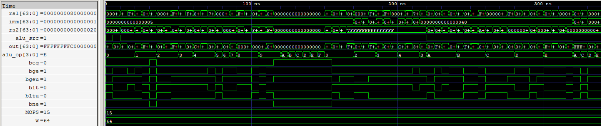
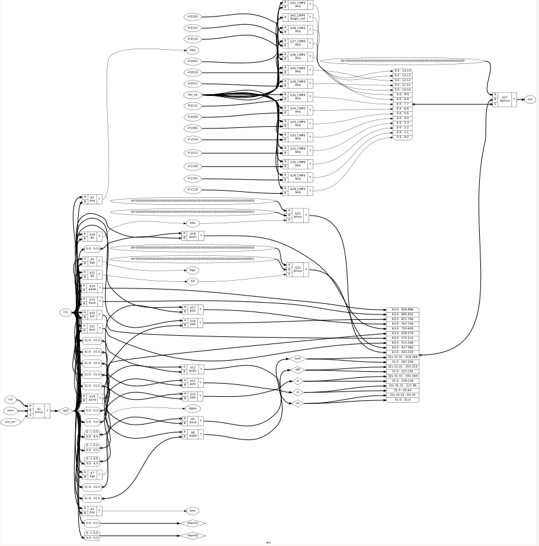

# RV64I ALU

- A parameterized 64-bit combinational Arithmetic Logic Unit implementing arithmetic, logical, shift, and comparison operations for the documented RV64I instruction subset.
- Supports **64-bit operations and 32-bit word operations**, including ADDW, SUBW, SLLW, SRLW, and SRAW.
- Uses behavioral addition and subtraction operators for arithmetic operations.
- Supports register-register and register-immediate operations through an operand-selection input.
- Generates six branch-condition signals for equality, signed comparisons, and unsigned comparisons.
- Verified using directed RTL test vectors and gate-level simulation (GLS) after synthesis and technology mapping.

  
   
  RV64I ALU Waveform

### Supported Operations

| Opcode | Operation | Description                                                       |
| ------ | --------- | ----------------------------------------------------------------- |
| `0000` | ADD       | 64-bit addition (`rs1 + op2`)                                     |
| `0001` | SUB       | 64-bit subtraction (`rs1 - op2`)                                  |
| `0010` | SLL       | 64-bit logical left shift                                         |
| `0011` | SRL       | 64-bit logical right shift                                        |
| `0100` | SRA       | 64-bit arithmetic right shift                                     |
| `0101` | AND       | Bitwise AND (`rs1 & op2`)                                         |
| `0110` | OR        | Bitwise OR (`rs1 \| op2`)                                         |
| `0111` | XOR       | Bitwise XOR (`rs1 ^ op2`)                                         |
| `1000` | SLT       | Signed less-than comparison; returns `1` or `0`                   |
| `1001` | SLTU      | Unsigned less-than comparison; returns `1` or `0`                 |
| `1010` | ADDW      | 32-bit addition; sign-extends the result to 64 bits               |
| `1011` | SUBW      | 32-bit subtraction; sign-extends the result to 64 bits            |
| `1100` | SLLW      | 32-bit logical left shift; sign-extends the result to 64 bits     |
| `1101` | SRLW      | 32-bit logical right shift; sign-extends the result to 64 bits    |
| `1110` | SRAW      | 32-bit arithmetic right shift; sign-extends the result to 64 bits |
| `1111` | Invalid   | Output defaults to zero                                           |

Operand selection: `op2 = alu_src ? imm : rs2`

For 64-bit register shifts, the shift amount is `rs2[5:0]`; for immediate shifts, it is `imm[5:0]`. Word-sized register shifts use `rs2[4:0]`, while immediate word shifts use `imm[4:0]`.

### Word Operations

Word operations perform arithmetic or shifting on the **lower 32 bits** of the operands. The resulting 32-bit value is then sign-extended to 64 bits.

The five word operation codes also support the corresponding immediate operations through `alu_src`:

| Instruction | ALU Operation | Operand Selection |
| ----------- | ------------- | ----------------- |
| ADDIW       | ADDW          | Immediate         |
| SLLIW       | SLLW          | Immediate         |
| SRLIW       | SRLW          | Immediate         |
| SRAIW       | SRAW          | Immediate         |

### Branch Condition Outputs

The ALU generates six branch-condition signals by comparing `rs1` with `op2`. For branch instructions, the control unit deasserts `alu_src`, selecting `rs2` as the second operand (`op2 = rs2`).

| Signal | Branch | Condition             |
| ------ | ------ | --------------------- |
| `beq`  | BEQ    | `rs1 == op2`          |
| `bne`  | BNE    | `rs1 != op2`          |
| `blt`  | BLT    | Signed `rs1 < op2`    |
| `bge`  | BGE    | Signed `rs1 >= op2`   |
| `bltu` | BLTU   | Unsigned `rs1 < op2`  |
| `bgeu` | BGEU   | Unsigned `rs1 >= op2` |

### Verification

- RTL simulation: Directed test vectors covering arithmetic, logical, shift, comparison, branch-condition, word-operation, and invalid-opcode behavior.
- Gate-level simulation: Passed using the synthesized and technology-mapped netlist.
- Arithmetic edge cases: Tested signed boundaries, all-ones operands, and 64-bit overflow behavior.
- Shift operations: Tested boundary shift amounts, including `0`, `1`, and `63`, along with immediate shift-amount handling.
- Word operations: Verified 32-bit arithmetic and shift behavior, including sign extension to 64 bits and immediate-source operation.
- Invalid opcodes: Verified that encoding `1111` produces zero.

  
   
  RV64I ALU Synthesized Netlist

Gate-level simulation was performed after synthesis and technology mapping to verify the ALU's behavior in the Sky130HD implementation.
