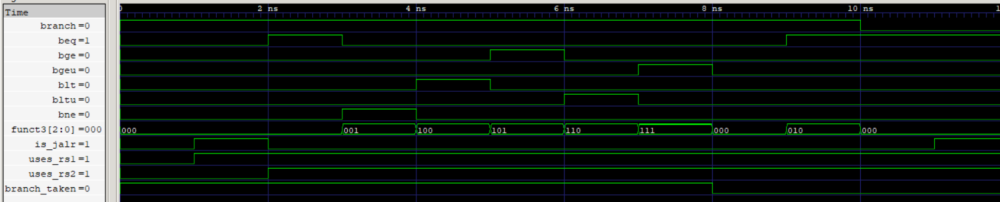

# Branch Control Unit (BCU)

The Branch Control Unit (BCU) determines whether a control-flow instruction should redirect program execution. It evaluates conditional branch instructions using comparison signals generated by the ALU and identifies unconditional jumps (JAL and JALR). It generates `branch_taken`, which is used by the Branch Handling Unit (BHU) and Program Counter (PC) logic to handle control-flow redirection.

  
   
  Branch Control Unit

## Features

- Supports all six RV64I conditional branch conditions.
- Handles unconditional JAL and JALR instructions.
- Selects the appropriate ALU comparison result using `funct3`.
- Distinguishes conditional branches, JAL, and JALR using CU metadata.
- Generates a single `branch_taken` signal for control-flow handling.

## Interface

| Signal | Direction | Width | Description |
|---|---|---:|---|
| `branch` | Input | 1 | Identifies a valid conditional branch or jump instruction |
| `uses_rs1` | Input | 1 | Indicates whether the instruction uses source register rs1 |
| `uses_rs2` | Input | 1 | Indicates whether the instruction uses source register rs2 |
| `is_jalr` | Input | 1 | Identifies a JALR instruction |
| `beq` | Input | 1 | ALU equality comparison result |
| `bne` | Input | 1 | ALU inequality comparison result |
| `bge` | Input | 1 | ALU signed greater-than-or-equal comparison result |
| `blt` | Input | 1 | ALU signed less-than comparison result |
| `bgeu` | Input | 1 | ALU unsigned greater-than-or-equal comparison result |
| `bltu` | Input | 1 | ALU unsigned less-than comparison result |
| `funct3` | Input | FB | Selects the conditional branch operation |
| `branch_taken` | Output | 1 | Indicates whether control flow should be redirected |

## Branch and Jump Handling

The BCU receives the registered control metadata from the ID/EX pipeline register when an instruction reaches the EX stage.

The `branch` signal identifies a valid conditional branch or jump instruction. The BCU distinguishes between the instruction types using `is_jalr`, `uses_rs1`, and `uses_rs2`.

| Instruction | branch | is_jalr | uses_rs1 | uses_rs2 | BCU behavior |
|---|---|---|---|---|---|
| Conditional Branch | 1 | 0 | 1 | 1 | Selects the comparison result using `funct3` |
| JAL | 1 | 0 | 0 | 0 | Asserts `branch_taken` |
| JALR | 1 | 1 | 1 | 0 | Asserts `branch_taken` |
| Other Instructions | 0 | 0 | Depends | Depends | Deasserts `branch_taken` |

### Conditional Branch Selection

For conditional branches, the BCU selects the corresponding ALU comparison output based on `funct3`.

| `funct3` | Instruction | Selected Signal |
|---|---|---|
| `000` | BEQ | `beq` |
| `001` | BNE | `bne` |
| `100` | BLT | `blt` |
| `101` | BGE | `bge` |
| `110` | BLTU | `bltu` |
| `111` | BGEU | `bgeu` |

Unsupported `funct3` encodings result in `branch_taken = 0`.

### ALU Integration

The ALU generates six comparison signals using its input operands. These operands are supplied through the EX Forwarding Unit (EFU), ensuring that branch decisions use the latest available register values.

The BCU selects the appropriate comparison result and generates `branch_taken`.

For JAL and JALR, `branch_taken` is asserted unconditionally when the corresponding valid jump instruction reaches EX.

The Target Address Generator (TAG) independently calculates the branch or jump target. The resulting control signals are used by the PC and Branch Handling Unit (BHU) to redirect execution and flush younger instructions when necessary.

## Verification

- **RTL Simulation:** 12 directed test cases covering JAL, JALR, all six conditional branch conditions, false branch conditions, unsupported `funct3`, and invalid branch control.
- **Gate-Level Simulation (GLS):** All 12 directed test cases passed, matching RTL behavior.
