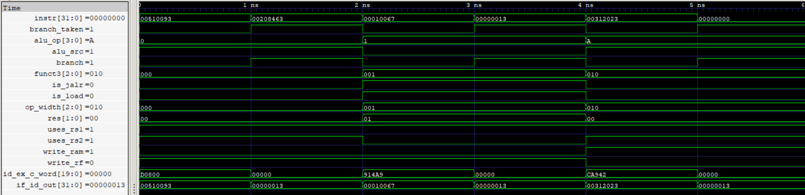

# Branch Handling Unit (BHU)

The Branch Handling Unit (BHU) handles pipeline flushing when a branch or jump is taken. It generates a zeroed control word for the ID/EX pipeline register to insert a bubble and injects the RISC-V NOP instruction into the IF/ID pipeline register, preventing younger instructions from executing along the incorrect control-flow path.

<p align="center">
  
  <br>
  <sub>Branch Handling Unit</sub>
</p>

## Features

- Handles pipeline flushing when `branch_taken` is asserted.
- Inserts a bubble by zeroing the ID/EX control word.
- Injects the RISC-V NOP instruction into the IF/ID pipeline register.
- Preserves the original control word and instruction when no branch is taken.
- Supports the 20-bit control-word format used by the pipeline.

## Interface

| Signal | Direction | Width | Description |
|---|---|---:|---|
| `branch` | Input | 1 | Identifies a valid conditional branch or jump instruction |
| `write_rf` | Input | 1 | Register-file write enable |
| `alu_op` | Input | 4 | ALU operation selection |
| `alu_src` | Input | 1 | Selects the ALU's second operand source |
| `is_jalr` | Input | 1 | Identifies a JALR instruction |
| `op_width` | Input | 3 | Selects the memory operation width |
| `write_ram` | Input | 1 | RAM write enable |
| `res` | Input | 2 | Selects the write-back result source |
| `uses_rs1` | Input | 1 | Indicates whether the instruction uses source register rs1 |
| `uses_rs2` | Input | 1 | Indicates whether the instruction uses source register rs2 |
| `is_load` | Input | 1 | Identifies a load instruction |
| `branch_taken` | Input | 1 | Indicates that control flow must be redirected |
| `funct3` | Input | 3 | Instruction function field carried in the control word |
| `instr` | Input | 32 | Instruction entering the IF/ID pipeline register |
| `id_ex_c_word` | Output | 20 | Control word entering the ID/EX pipeline register |
| `if_id_out` | Output | 32 | Instruction entering the IF/ID pipeline register |

## Pipeline Flushing

The BHU receives `branch_taken` from the Branch Control Unit (BCU) when a branch or jump resolves in the EX stage.

When `branch_taken = 1`, the BHU performs two operations:

1. **ID/EX Flush:** Sets the entire 20-bit control word to zero, inserting a bubble for the instruction currently in ID.
2. **IF/ID Flush:** Injects the RISC-V NOP instruction (`32'h00000013`) into the IF/ID pipeline register, replacing the younger instruction fetched along the incorrect path.

When `branch_taken = 0`, both the original control word and instruction pass through unchanged.

### NOP Injection

The injected instruction is the standard RISC-V NOP encoding:

```systemverilog
32'h00000013  // ADDI x0, x0, 0
```

It is decoded by the CU as an ordinary ADDI instruction. Since its destination is `x0`, it produces no architectural state change.

### Integration

The BHU works alongside the BCU, PC, and pipeline registers.

- **BCU:** Determines whether a branch or jump is taken.
- **BHU:** Generates the required flush and bubble signals through its outputs.
- **PC:** Redirects execution to the calculated target address.
- **Pipeline Registers:** Capture the modified control word and instruction, flushing younger instructions when required.

## Verification

- **RTL Simulation:** 6 directed test cases covering normal instruction pass-through, branch flushing, JALR flushing, control-word suppression, and NOP injection.
- **Gate-Level Simulation (GLS):** All 6 directed test cases passed, matching RTL behavior.
