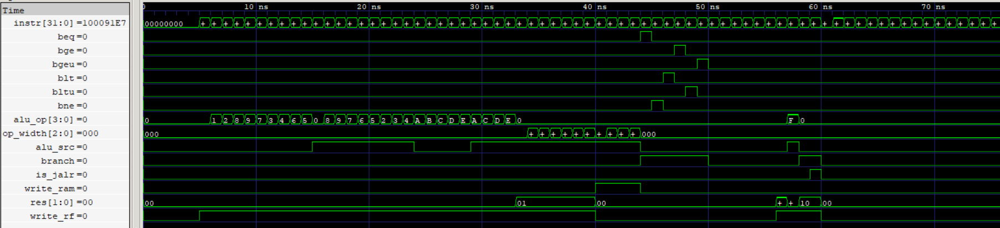

# Control Unit (CU)

The Control Unit (CU) is a combinational instruction decoder responsible for generating the control signals required to execute supported RV64I instructions.

It operates in the Instruction Decode (ID) stage of the 5-stage pipeline. Based on the instruction opcode, `funct3`, and `funct7` fields, it generates the appropriate datapath control signals. For conditional branches, it also evaluates the branch condition flags received from the ALU to determine whether a PC redirect is required.

The CU supports 49 instructions across arithmetic, logical, memory, branch, and control-transfer operations.

## Features

- Decodes R-type, I-type, S-type, B-type, U-type, and J-type instruction formats.
- Generates ALU operation selection and operand selection controls.
- Generates register-file and data-memory write controls.
- Selects the appropriate write-back result source.
- Evaluates conditional branch outcomes using ALU comparison flags.
- Handles unconditional jumps (JAL and JALR).
- Generates `uses_rs1` and `uses_rs2` metadata to identify source-register usage for forwarding and hazard detection.
- Generates `is_load` to identify load instructions for load-use hazard detection.
- Uses deterministic default control values for unsupported instructions and encodings.

<p align="center">
  
  <br>
  <sub>Control Unit producing control words for corresponding Instructions</sub>
</p>

## Supported Instructions

| Instruction Class | Supported Instructions                               |  Count |
| ----------------- | ---------------------------------------------------- | -----  |
| OP                | ADD, SUB, SLL, SLT, SLTU, XOR, SRL, SRA, OR, AND     |     10 |
| OP-IMM            | ADDI, SLTI, SLTIU, XORI, ORI, ANDI, SLLI, SRLI, SRAI |      9 |
| OP-32             | ADDW, SUBW, SLLW, SRLW, SRAW                         |      5 |
| OP-IMM-32         | ADDIW, SLLIW, SRLIW, SRAIW                           |      4 |
| LOAD              | LB, LH, LW, LD, LBU, LHU, LWU                        |      7 |
| STORE             | SB, SH, SW, SD                                       |      4 |
| BRANCH            | BEQ, BNE, BLT, BGE, BLTU, BGEU                       |      6 |
| U-type            | LUI, AUIPC                                           |      2 |
| JUMP              | JAL, JALR                                            |      2 |
| **Total**         |                                                      | **49** |

## Interface

### Inputs

| Signal  |   Width | Description                                         |
| ------- | ------  | --------------------------------------------------- |
| `instr` | 32 bits | Instruction supplied by the IF/ID pipeline register |
| `beq`   |   1 bit | ALU equality condition                              |
| `bne`   |   1 bit | ALU inequality condition                            |
| `blt`   |   1 bit | ALU signed less-than condition                      |
| `bge`   |   1 bit | ALU signed greater-than-or-equal condition          |
| `bltu`  |   1 bit | ALU unsigned less-than condition                    |
| `bgeu`  |   1 bit | ALU unsigned greater-than-or-equal condition        |

### Outputs

| Signal       |  Width | Description                                     |
| ------------ | -----  | ----------------------------------------------- |
| `branch`     |  1 bit | Indicates an effective PC redirect              |
| `write_rf`   |  1 bit | Register-file write enable                      |
| `alu_op`     | 4 bits | ALU operation selection                         |
| `alu_src`    |  1 bit | Selects ALU operand 2: register or immediate    |
| `is_jalr`    |  1 bit | Selects JALR target-address calculation         |
| `op_width`   | 3 bits | Memory operation width and signedness selection |
| `write_ram`  |  1 bit | Data-memory write enable                        |
| `is_load`    |  1 bit | Identifies a load instruction for hazard detection |
| `res`        | 2 bits | Write-back result source selection              |
| `uses_rs1`   |  1 bit | Indicates whether the instruction uses `rs1` (forwarding metadata) |
| `uses_rs2`   |  1 bit | Indicates whether the instruction uses `rs2` (forwarding metadata) |

`uses_rs1` and `uses_rs2` identify actual source-register usage independently of the instruction's execution outcome. These signals are used by forwarding and hazard-handling logic and do not directly control the datapath.

`is_load` identifies valid load instructions (LB, LH, LW, LD, LBU, LHU, and LWU). It is used by the Hazard Detection Unit to detect load-use dependencies.

## Control Word Format

The CU generates a **17-bit control word**:

```text
{uses_rs1, uses_rs2, branch, write_rf, alu_op[3:0], alu_src, is_jalr, op_width[2:0], write_ram, is_load, res[1:0]}
```

## Verification

The Control Unit was verified using a self-checking SystemVerilog testbench.

**Verification coverage:**

- All 49 supported instruction decodings.
- All six conditional branch instructions with taken and not-taken conditions.
- Representative invalid opcodes and unsupported instruction encodings.
- Invalid `funct3` and `funct7` combinations.
- Invalid shift-immediate encodings.
- Individual verification of all output control signals, including source-usage metadata and `is_load`.

| Verification Stage          | Result     |
| --------------------------- | ---------- |
| RTL Simulation              | 71/71 PASS |
| Gate-Level Simulation (GLS) | 71/71 PASS |
| Synthesis                   | Completed  |

All 71 directed test cases passed in both RTL simulation and gate-level simulation.
