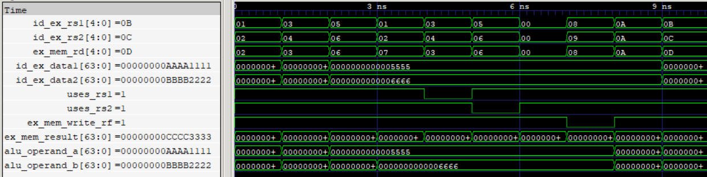

# EX-to-EX Forwarding (EEF) Unit

The EX-to-EX Forwarding (EEF) unit resolves Read-After-Write (RAW) data dependencies between consecutive instructions in the five-stage pipeline. It detects source-register matches between the instruction in the EX stage and the destination register of the preceding instruction in the EX/MEM pipeline register.

When a dependency is detected, the EEF unit forwards the result from EX/MEM directly to the corresponding ALU input, avoiding the need to wait for register-file write-back.

<p align="center">
  
  <br>
  <sub>EX-EX Forwarding</sub>
</p>

## Features

- Supports independent forwarding paths for both ALU operands.
- Detects RAW dependencies by comparing source and destination register indices.
- Uses `uses_rs1` and `uses_rs2` metadata to qualify source-register comparisons.
- Prevents forwarding from the zero register (`x0`).
- Qualifies forwarding using the EX/MEM register-file write control.
- Supports simultaneous forwarding to both ALU operands.
- Provides original ID/EX operands when no forwarding condition is satisfied.
- Implements combinational forwarding logic without additional pipeline latency.

## Interface

| Signal             | Direction | Width   | Description                                      |
| ------------------ | --------- | ------- | ------------------------------------------------ |
| `id_ex_rs1`        | Input     | 5 bits  | First source register index from ID/EX           |
| `id_ex_rs2`        | Input     | 5 bits  | Second source register index from ID/EX          |
| `id_ex_data1`      | Input     | 64 bits | Original first source operand from ID/EX         |
| `id_ex_data2`      | Input     | 64 bits | Original second source operand from ID/EX        |
| `ex_mem_result`    | Input     | 64 bits | Result available in EX/MEM                       |
| `ex_mem_write_rf`  | Input     | 1 bit   | EX/MEM register-file write control               |
| `ex_mem_rd`        | Input     | 5 bits  | Destination register index from EX/MEM           |
| `uses_rs1`         | Input     | 1 bit   | Indicates whether the current instruction uses rs1 |
| `uses_rs2`         | Input     | 1 bit   | Indicates whether the current instruction uses rs2 |
| `alu_operand_a`    | Output    | 64 bits | First ALU operand after forwarding selection     |
| `alu_operand_b`    | Output    | 64 bits | Second ALU operand after forwarding selection    |

## Forwarding Logic

The EEF unit independently checks both source operands against the destination register in EX/MEM.

A forwarding condition is asserted when:

- The corresponding source register is used by the current instruction.
- The source register is not `x0`.
- The source register index matches `ex_mem_rd`.
- The EX/MEM instruction enables register-file write-back.

The forwarding conditions are:

```systemverilog
forward1 = (ex_mem_rd != 0) &&
           (id_ex_rs1 == ex_mem_rd) &&
           uses_rs1 &&
           ex_mem_write_rf;

forward2 = (ex_mem_rd != 0) &&
           (id_ex_rs2 == ex_mem_rd) &&
           uses_rs2 &&
           ex_mem_write_rf;
```

The resulting forwarding decisions control two independent operand-selection paths:

```systemverilog
alu_operand_a = forward1 ? ex_mem_result : id_ex_data1;
alu_operand_b = forward2 ? ex_mem_result : id_ex_data2;
```

If a dependency is detected, the corresponding ALU operand receives the EX/MEM result. Otherwise, the original operand from ID/EX is selected.

### Source-Usage Qualification

The `uses_rs1` and `uses_rs2` signals prevent false forwarding conditions caused by instruction fields that do not represent actual source-register dependencies.

For example, an immediate instruction may contain a bit pattern in the `rs2` field position, but that field is part of the immediate rather than a source-register index. The source-usage metadata prevents such a match from triggering forwarding.

## Verification

- RTL simulation: 10 directed test vectors verified.
- Gate-level simulation: 10 directed test vectors verified using the synthesized and technology-mapped netlist.
- Independent forwarding: Verified forwarding to `alu_operand_a` and `alu_operand_b` separately.
- Simultaneous forwarding: Verified both operands receiving the EX/MEM result.
- Dependency detection: Verified matching and non-matching source/destination register indices.
- Source qualification: Verified that unused source registers do not trigger forwarding.
- Zero-register handling: Verified that forwarding from `x0` is prevented.
- Write qualification: Verified that forwarding is disabled when `ex_mem_write_rf` is deasserted.
- Operand selection: Verified original ID/EX operand pass-through when forwarding is not required.
