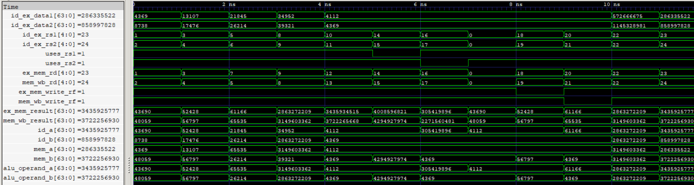

# EX Forwarding (EFU) Unit

The EX Forwarding (EFU) unit integrates the EX-to-EX Forwarding (EEF) and MEM-to-EX Forwarding (MEF) units to resolve Read-After-Write (RAW) data dependencies in the five-stage pipeline.

It selects the appropriate ALU operands from three possible sources: the original operands stored in ID/EX, the result available in EX/MEM, or the result available in MEM/WB. When both forwarding paths detect a dependency for the same operand, EX/MEM takes priority because it contains the more recent result.

<p align="center">
  
  <br>
  <sub>EX Forwarding and Priority Selection</sub>
</p>

## Features

- Integrates EEF and MEF for EX-stage operand forwarding.
- Supports three possible operand sources: ID/EX, EX/MEM, and MEM/WB.
- Implements independent forwarding selection for both ALU operands.
- Prioritizes EX/MEM over MEM/WB when both forwarding conditions match the same source register.
- Supports simultaneous forwarding from different pipeline stages to separate ALU operands.
- Preserves original ID/EX operands when no forwarding condition is satisfied.
- Uses `uses_rs1` and `uses_rs2` metadata through the integrated forwarding units.
- Prevents forwarding from the zero register (`x0`).
- Implements combinational forwarding selection without additional pipeline latency.

## Interface

| Signal | Direction | Width | Description |
|---|---|---|---|
| `id_ex_rs1` | Input | 5 bits | First source register index from ID/EX |
| `id_ex_rs2` | Input | 5 bits | Second source register index from ID/EX |
| `id_ex_data1` | Input | 64 bits | Original first source operand from ID/EX |
| `id_ex_data2` | Input | 64 bits | Original second source operand from ID/EX |
| `ex_mem_result` | Input | 64 bits | Result available in EX/MEM |
| `ex_mem_write_rf` | Input | 1 bit | EX/MEM register-file write control |
| `ex_mem_rd` | Input | 5 bits | Destination register index from EX/MEM |
| `mem_wb_rd` | Input | 5 bits | Destination register index from MEM/WB |
| `mem_wb_write_rf` | Input | 1 bit | MEM/WB register-file write control |
| `mem_wb_result` | Input | 64 bits | Result available in MEM/WB |
| `uses_rs1` | Input | 1 bit | Indicates whether the current instruction uses rs1 |
| `uses_rs2` | Input | 1 bit | Indicates whether the current instruction uses rs2 |
| `alu_operand_a` | Output | 64 bits | First ALU operand after forwarding selection |
| `alu_operand_b` | Output | 64 bits | Second ALU operand after forwarding selection |

## Forwarding Architecture

The EFU instantiates two independent forwarding units:

- **EEF:** Detects EX/MEM-to-EX dependencies.
- **MEF:** Detects MEM/WB-to-EX dependencies.

Both units independently evaluate the source-register dependencies and provide candidate operands to the EFU.

The EFU then performs priority selection independently for each ALU operand.

### Priority Selection

A forwarding condition from EX/MEM takes priority over MEM/WB when both match the same source register.

The selection logic is:

```systemverilog
alu_operand_a = priority_ex1 ? id_a : mem_a;
alu_operand_b = priority_ex2 ? id_b : mem_b;
```

Where:

- `id_a` and `id_b` are the candidate operands from EEF.
- `mem_a` and `mem_b` are the candidate operands from MEF.
- `priority_ex1` and `priority_ex2` indicate matching EX/MEM forwarding conditions for the respective source registers.

The resulting selection supports independent forwarding decisions for both operands.

For example, if `rs1` matches the EX/MEM destination while `rs2` matches the MEM/WB destination, the EFU selects EX/MEM for operand A and MEM/WB for operand B.

If neither forwarding condition matches an operand, its original ID/EX value is preserved through the corresponding forwarding unit.

## Verification

- RTL simulation: 12 directed test vectors verified.
- Gate-level simulation: 12 directed test vectors verified using the synthesized and technology-mapped netlist.
- Independent forwarding: Verified separate forwarding selections for both ALU operands.
- Mixed-source forwarding: Verified one operand receiving EX/MEM data while the other receives MEM/WB data, in both combinations.
- Priority selection: Verified EX/MEM priority when both forwarding units detect a match for the same source register.
- Dependency detection: Verified matching and non-matching source/destination register indices.
- Source qualification: Verified that unused source registers do not trigger forwarding.
- Zero-register handling: Verified that forwarding from `x0` is prevented.
- Write qualification: Verified that both EX/MEM and MEM/WB write controls correctly qualify forwarding.
- Operand selection: Verified original ID/EX operand pass-through when forwarding is not required.
