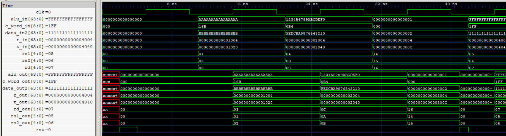

# EX/MEM Pipeline Register

The EX/MEM pipeline register stores the execution stage's ALU result, forwarded store data, TAG outputs, remaining control signals, and register indices between the Execute (EX) and Memory (MEM) stages. It captures all seven fields synchronously on the rising edge of the clock and supports asynchronous reset.

  
   
  EX/MEM Pipeline Register

## Features

- 274-bit pipeline register organized into seven independently accessible fields.
- Stores a 64-bit ALU result and 64-bit forwarded store-data operand.
- Carries the 64-bit TAG return address (`r_out`) and target address (`t_out`).
- Carries the 8-bit control word containing the control signals required by subsequent stages.
- Stores 5-bit `rs2` and `rd` register indices for forwarding and dependency tracking.
- Synchronous data capture on the rising edge of the clock.
- Asynchronous active-high reset.
- Independent input and output interfaces for every field.

## Interface

| Signal | Direction | Width | Description |
|---|---|---:|---|
| `alu_in` | Input | 64 bits | ALU result from EX |
| `data_in2` | Input | 64 bits | Forwarded second source operand for store operations |
| `r_in` | Input | 64 bits | Return address from TAG |
| `t_in` | Input | 64 bits | Target address from TAG |
| `c_word_in` | Input | 8 bits | Remaining control word from EX |
| `rs2` | Input | 5 bits | Second source register index |
| `rd` | Input | 5 bits | Destination register index |
| `clk` | Input | 1 bit | Clock signal |
| `rst` | Input | 1 bit | Asynchronous active-high reset |
| `alu_out` | Output | 64 bits | Registered ALU result |
| `data_out2` | Output | 64 bits | Registered store-data operand |
| `r_out` | Output | 64 bits | Registered return address |
| `t_out` | Output | 64 bits | Registered target address |
| `c_word_out` | Output | 8 bits | Registered control word |
| `rs2_out` | Output | 5 bits | Registered second source register index |
| `rd_out` | Output | 5 bits | Registered destination register index |

## Payload Organization

The register stores a total of 274 bits across seven fields.

| Field | Width |
|---|---:|
| ALU Result | 64 bits |
| Store Data | 64 bits |
| TAG Return Address | 64 bits |
| TAG Target Address | 64 bits |
| Control Word | 8 bits |
| `rs2` | 5 bits |
| `rd` | 5 bits |
| **Total** | **274 bits** |

## Operation

All seven fields are captured together on every rising clock edge.

During asynchronous reset, all registered outputs are cleared to zero without waiting for the next clock edge.

The ALU result is used by subsequent memory and writeback operations. The forwarded second source operand is retained separately as store data, allowing store instructions to receive the correct operand after EX-stage forwarding.

The TAG outputs carry the return address and target address required by subsequent pipeline operations and writeback.

The 8-bit control word carries the remaining control signals needed by the MEM and WB stages. EX-stage signals such as `alu_op`, `alu_src`, `branch`, `funct3`, and `is_jalr` are consumed within EX and are not propagated further.

The `uses_rs1` metadata bit is discarded after EX because no subsequent stage requires it. The `uses_rs2` bit is retained for MEM-stage store-data dependency checking and forwarding through MMF. The `rs2` register index supports this dependency check, while `rd` identifies the destination register for forwarding and writeback.

## Verification

- RTL simulation: Directed test scenarios passed.
- Gate-level simulation: Directed test scenarios passed using the synthesized and technology-mapped netlist.
- Asynchronous reset: Verified clearing of all seven fields.
- Sequential capture: Verified simultaneous capture of all fields.
- ALU result propagation: Verified 64-bit ALU result capture.
- Store-data propagation: Verified 64-bit store-data operand capture.
- TAG propagation: Verified return address and target address capture.
- Register indices: Verified `rs2` and `rd` propagation.
- Control propagation: Verified 8-bit control word capture, including a zero control word.
