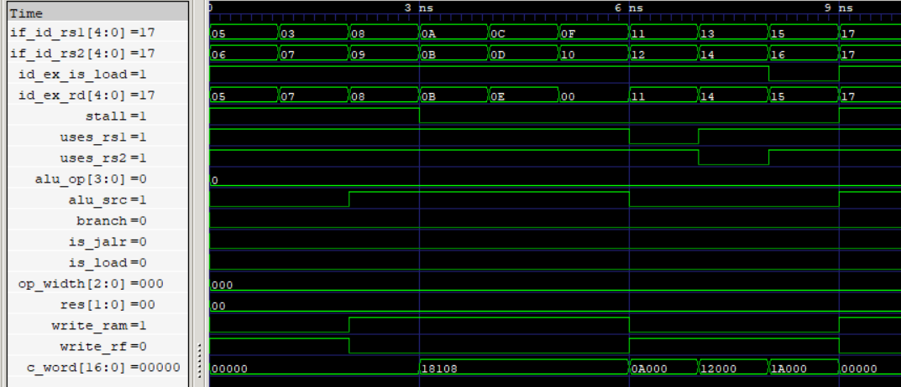

# Hazard Detection Unit (HDU)

The Hazard Detection Unit (HDU) detects load-use Read-After-Write (RAW) data hazards in the five-stage pipeline.

It compares the destination register of the instruction currently in the ID/EX pipeline register against the source registers of the instruction currently being decoded in the ID stage. When a load-use dependency is detected, the HDU asserts `stall` to hold the PC and IF/ID pipeline register, preventing the dependent instruction from advancing.

The HDU simultaneously forces the control word to zero, inserting a bubble into ID/EX while allowing the load instruction to continue through the pipeline.

<p align="center">
  
  <br>
  <sub>Hazard Detection Unit</sub>
</p>

## Features

- Detects load-use RAW dependencies between ID/EX and IF/ID instructions.
- Compares the load destination register against both source-register indices.
- Uses `uses_rs1` and `uses_rs2` metadata to qualify source-register comparisons.
- Prevents unnecessary stalls when the destination register is `x0`.
- Uses `id_ex_is_load` to identify load instructions currently in EX.
- Handles load-to-store dependencies selectively.
- Avoids unnecessary stalls for load-to-store `rs2` dependencies, which are handled by MMF.
- Asserts `stall` to hold the PC and IF/ID pipeline register.
- Forces the 20-bit control word to zero to insert a bubble into ID/EX.
- Allows EX/MEM and MEM/WB pipeline registers to continue advancing.
- Implements combinational hazard detection without additional pipeline latency.

## Interface

| Signal | Direction | Width | Description |
|---|---|---|---|
| `branch` | Input | 1 bit | Branch/jump control from the current CU instruction |
| `write_rf` | Input | 1 bit | Register-file write control from CU |
| `alu_op` | Input | 4 bits | ALU operation selection from CU |
| `alu_src` | Input | 1 bit | ALU operand selection from CU |
| `is_jalr` | Input | 1 bit | JALR target calculation control from CU |
| `op_width` | Input | 3 bits | Memory operation width from CU |
| `write_ram` | Input | 1 bit | Data-memory write control; identifies store instructions |
| `res` | Input | 2 bits | Write-back result selection from CU |
| `uses_rs1` | Input | 1 bit | Indicates whether the IF/ID instruction uses `rs1` |
| `uses_rs2` | Input | 1 bit | Indicates whether the IF/ID instruction uses `rs2` |
| `is_load` | Input | 1 bit | Load identification from the current CU instruction |
| `id_ex_is_load` | Input | 1 bit | Identifies whether the ID/EX instruction is a load |
| `if_id_rs1` | Input | 5 bits | First source-register index from IF/ID |
| `if_id_rs2` | Input | 5 bits | Second source-register index from IF/ID |
| `id_ex_rd` | Input | 5 bits | Destination-register index from ID/EX |
| `funct3` | Input | 3 bits | Instruction function field carried in the control word |
| `stall` | Output | 1 bit | Indicates a detected load-use hazard |
| `c_word` | Output | 20 bits | Gated 20-bit control word passed towards ID/EX |

## Hazard Detection Logic

The HDU checks whether the instruction in ID/EX is a load and whether its destination register matches a source register used by the instruction currently in IF/ID.

A stall is asserted when:

- The ID/EX instruction is a load.
- Its destination register is not `x0`.
- A source-register dependency exists.
- The corresponding source register is actually used by the IF/ID instruction.

The load-use detection conditions are:

```systemverilog
stall = (id_ex_rd != 0 && if_id_rs1 == id_ex_rd &&
         uses_rs1 && id_ex_is_load && !write_ram) ||

        (id_ex_rd != 0 && if_id_rs2 == id_ex_rd &&
         uses_rs2 && id_ex_is_load && !write_ram) ||

        (id_ex_rd != 0 && if_id_rs1 == id_ex_rd &&
         uses_rs1 && id_ex_is_load && write_ram);
```

### Load-to-Store Dependency Handling

Store instructions consume two source registers differently:

- `rs1` is required in EX for effective-address calculation.
- `rs2` is required in MEM as the store data.

Therefore:

- A load dependency involving store `rs1` requires a stall.
- A load dependency involving store `rs2` does not require a stall because MMF forwards the loaded result directly to the RAM write-data input.

This avoids unnecessary pipeline stalls while preserving correct data dependencies.

## Stall and Bubble Insertion

When `stall` is asserted, the HDU forces the outgoing control word to zero:

```systemverilog
c_word = stall ? 20'b0 : control_word;
```

The 20-bit control word contains the CU-generated controls and instruction metadata:

```systemverilog
{uses_rs1, uses_rs2, branch, write_rf, alu_op[3:0],
 alu_src, is_jalr, op_width[2:0], write_ram, is_load,
 res[1:0], funct3[2:0]}
```

The zero control word inserts a bubble into ID/EX, preventing unintended register-file writes, memory writes, or other control actions.

During the stall:

- PC holds its current value.
- IF/ID retains the dependent instruction.
- ID/EX receives a bubble.
- EX/MEM and MEM/WB continue advancing normally.

## Verification

- RTL simulation: 10 directed test vectors verified.
- Gate-level simulation: 10 directed test vectors verified using the synthesized and technology-mapped netlist.
- `rs1` dependency: Verified load-use detection through the first source register.
- `rs2` dependency: Verified load-use detection through the second source register.
- Load-to-store `rs1`: Verified that address dependencies trigger a stall.
- Load-to-store `rs2`: Verified that store-data dependencies do not trigger a stall.
- Zero-register handling: Verified that dependencies involving destination `x0` do not trigger a stall.
- Source qualification: Verified that unused source registers do not trigger false hazards.
- Load qualification: Verified that non-load instructions in ID/EX do not trigger stalls.
- Bubble insertion: Verified that the entire 20-bit control word is zeroed when a stall is asserted.
- Control pass-through: Verified that the original CU control word, including `funct3`, passes through when no stall is detected.
