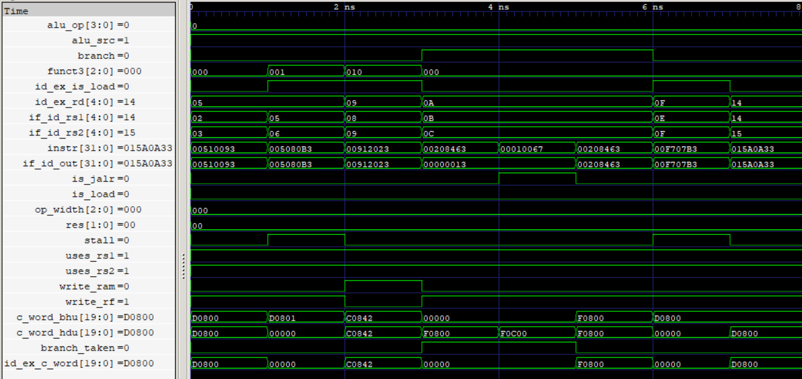

# Hazard Handling Unit (HHU)

The Hazard Handling Unit (HHU) integrates the Hazard Detection Unit (HDU) and Branch Handling Unit (BHU) to manage data and control hazards in the five-stage pipeline.

It selects the appropriate ID/EX control word based on `branch_taken`. During normal execution and load-use hazards, the HDU output is selected. When a branch or jump is taken, the BHU output takes precedence, ensuring that the ID/EX control word is zeroed and the IF/ID instruction is replaced with a RISC-V NOP.

<p align="center">
  
  <br>
  <sub>Hazard Handling Unit</sub>
</p>

## Features

- Integrates HDU and BHU for centralized pipeline hazard handling.
- Handles load-use RAW data hazards through HDU.
- Handles control hazards through BHU.
- Selects the BHU control-word output when `branch_taken` is asserted.
- Selects the HDU control-word output during normal execution and load-use stalls.
- Propagates the HDU `stall` signal to pipeline control.
- Supports the 20-bit control-word format, including `funct3`.
- Injects a RISC-V NOP into IF/ID when a branch or jump is taken.

## Interface

| Signal | Direction | Width | Description |
|---|---|---:|---|
| `branch` | Input | 1 bit | Identifies a valid conditional branch or jump instruction |
| `write_rf` | Input | 1 bit | Register-file write control from CU |
| `alu_op` | Input | 4 bits | ALU operation selection from CU |
| `alu_src` | Input | 1 bit | ALU operand selection from CU |
| `is_jalr` | Input | 1 bit | JALR target calculation control from CU |
| `op_width` | Input | 3 bits | Memory operation width from CU |
| `write_ram` | Input | 1 bit | Data-memory write control |
| `res` | Input | 2 bits | Write-back result selection from CU |
| `uses_rs1` | Input | 1 bit | Indicates whether the IF/ID instruction uses `rs1` |
| `uses_rs2` | Input | 1 bit | Indicates whether the IF/ID instruction uses `rs2` |
| `is_load` | Input | 1 bit | Load identification from the current CU instruction |
| `id_ex_is_load` | Input | 1 bit | Identifies whether the ID/EX instruction is a load |
| `if_id_rs1` | Input | 5 bits | First source-register index from IF/ID |
| `if_id_rs2` | Input | 5 bits | Second source-register index from IF/ID |
| `id_ex_rd` | Input | 5 bits | Destination-register index from ID/EX |
| `funct3` | Input | 3 bits | Instruction function field carried in the control word |
| `branch_taken` | Input | 1 bit | Indicates that control flow must be redirected |
| `instr` | Input | 32 bits | Instruction entering the IF/ID pipeline register |
| `stall` | Output | 1 bit | Indicates a detected load-use hazard |
| `id_ex_c_word` | Output | 20 bits | Selected control word passed towards ID/EX |
| `if_id_out` | Output | 32 bits | Instruction passed towards IF/ID |

## Hazard Handling and Output Selection

The HHU integrates two independent units:

- **HDU:** Detects load-use RAW dependencies, generates stalls, and suppresses the control word when a hazard is detected.
- **BHU:** Handles taken branches and jumps by zeroing the ID/EX control word and injecting a NOP into IF/ID.

The ID/EX control word is selected using `branch_taken`:

```systemverilog
assign id_ex_c_word = branch_taken ? c_word_bhu : c_word_hdu;
```

The IF/ID instruction is taken directly from the BHU output:

```systemverilog
assign if_id_out = bhu_if_id_out;
```

### Output Behavior

| Condition | `stall` | ID/EX Control Word | IF/ID Instruction |
|---|---:|---|---|
| Normal execution | 0 | HDU output (original control word) | Original instruction |
| Load-use hazard | 1 | HDU output (zero) | Original instruction |
| Branch/jump taken | 0 | BHU output (zero) | RISC-V NOP |

The `stall` signal is generated directly by HDU, while `branch_taken` controls the selection of the ID/EX control word.

## Verification

- **RTL Simulation:** 8 directed test cases covering normal execution, load-use hazards, load-to-store dependencies, branch flushing, and JALR flushing.
- **Gate-Level Simulation (GLS):** All 8 directed test cases passed, matching RTL behavior.
- **Load-use detection:** Verified both `rs1` and `rs2` dependencies.
- **Load-to-store handling:** Verified that store `rs2` dependencies do not cause unnecessary stalls.
- **Control-flow handling:** Verified conditional branch and JALR flushing.
- **Branch not taken:** Verified normal control-word and instruction pass-through.
- **Output selection:** Verified HDU/BHU control-word arbitration.
- **NOP injection:** Verified `32'h00000013` is passed to IF/ID when `branch_taken` is asserted.
