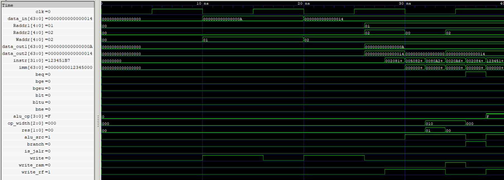

# Instruction Decode (ID) Stage

The Instruction Decode (ID) stage integrates the Register File (RF), Sign Extension Unit (SE), and Control Unit (CU) to read source operands, generate sign-extended immediates, and decode instructions into datapath control signals and source-usage metadata.

  
   
  ID Stage

## Features

- Supports two asynchronous register read ports and one synchronous register write port.
- Generates 64-bit sign-extended immediates for supported RV64I instruction formats.
- Decodes 49 supported RV64I instructions and generates the corresponding datapath control signals.
- Supports RV64I word-immediate instructions, including ADDIW, SLLIW, SRLIW, and SRAIW.
- Provides two 64-bit source operands for execution and memory operations.
- Supports register-file write-back through its write interface.
- Generates branch and jump metadata for subsequent branch-control logic.
- Provides `uses_rs1` and `uses_rs2` metadata for forwarding and hazard detection.
- Provides `funct3` for conditional branch identification.
- Generates memory operation width, ALU operation, operand selection, and result selection controls.
- Identifies load instructions through `is_load` metadata.

## Interface

| Signal | Direction | Width | Description |
|---|---|---|---|
| `Raddr1` | Input | 5 bits | First source register address |
| `Raddr2` | Input | 5 bits | Second source register address |
| `Waddr` | Input | 5 bits | Register-file write destination address |
| `data_in` | Input | 64 bits | Register-file write data |
| `write` | Input | 1 bit | Register-file write enable |
| `clk` | Input | 1 bit | Register-file clock |
| `instr` | Input | 32 bits | Instruction to decode |
| `branch` | Output | 1 bit | Indicates a valid branch or jump instruction |
| `write_rf` | Output | 1 bit | Register-file write control |
| `alu_op` | Output | 4 bits | Selects the ALU operation |
| `alu_src` | Output | 1 bit | Selects the ALU's second operand |
| `is_jalr` | Output | 1 bit | Identifies JALR target generation |
| `op_width` | Output | 3 bits | Selects memory operation width and signedness |
| `write_ram` | Output | 1 bit | Data-memory write control |
| `res` | Output | 2 bits | Selects the write-back result source |
| `uses_rs1` | Output | 1 bit | Indicates whether the instruction uses source register rs1 |
| `uses_rs2` | Output | 1 bit | Indicates whether the instruction uses source register rs2 |
| `funct3` | Output | 3 bits | Provides branch condition identification |
| `is_load` | Output | 1 bit | Identifies load instructions |
| `imm` | Output | 64 bits | Sign-extended instruction immediate |
| `data_out1` | Output | 64 bits | First source register data |
| `data_out2` | Output | 64 bits | Second source register data |

## Register Operand Read

The RF provides two asynchronous read ports for accessing source operands.

`data_out1` corresponds to `Raddr1`, while `data_out2` corresponds to `Raddr2`.

These operands are supplied to subsequent pipeline stages for arithmetic, logical, comparison, and memory address operations.

Register-file writes are performed synchronously through `Waddr`, `data_in`, and `write`.

## Immediate Generation

The SE extracts and reconstructs instruction immediates according to their respective RV64I instruction formats.

Supported formats include:

- I-type
- S-type
- B-type
- U-type
- J-type

The resulting immediate is sign-extended to 64 bits and provided through `imm`.

For word-immediate shift instructions (SLLIW, SRLIW, and SRAIW), the shift amount is extracted from the 5-bit `shamt` field and provided as a zero-extended value.

## Instruction Decoding

The CU decodes the instruction opcode, `funct3`, and `funct7` fields to generate the required datapath control signals.

It supports 49 instructions covering arithmetic, logical, shift, memory, branch, and control-transfer operations.

The CU generates branch and jump identification metadata. Conditional branch evaluation is handled separately by the Branch Control Unit (BCU), which uses `funct3` and the ALU comparison results to determine whether a branch is taken.

### Source-Usage Metadata

The ID stage provides two metadata signals:

- `uses_rs1`: Indicates whether the decoded instruction uses the `rs1` source register.
- `uses_rs2`: Indicates whether the decoded instruction uses the `rs2` source register.

These signals identify actual source-register dependencies independently of immediate operand selection or branch outcome. They are used by forwarding and hazard-detection logic in subsequent pipeline stages.

### Branch Metadata

The ID stage also provides:

- `branch`: Identifies valid conditional branch and jump instructions.
- `funct3`: Identifies the conditional branch operation.
- `is_jalr`: Identifies JALR instructions.

These signals are carried through the ID/EX pipeline register and supplied to the branch-control logic in the EX stage.

### Load Metadata

The `is_load` signal identifies load instructions and is carried through the pipeline for hazard detection.

The Hazard Detection Unit (HDU) uses this metadata to detect load-use dependencies and generate pipeline stalls.

## Verification

- RTL simulation: 65/65 directed integration checks passed.
- Gate-level simulation: 65/65 directed integration checks passed using the synthesized and technology-mapped netlist.
- RF integration: Verified register writes and dual-port asynchronous reads.
- Immediate generation: Verified I-type, S-type, and word-immediate shift extraction.
- Instruction decoding: Verified representative R-type, I-type, LOAD, STORE, BRANCH, and U-type instructions.
- Word-immediate instructions: Verified ADDIW, SLLIW, SRLIW, and SRAIW decoding and immediate generation.
- Operand propagation: Verified source register data for arithmetic and store operations.
- Control propagation: Verified ALU selection, register-file write control, memory write control, and result selection.
- Source-usage metadata: Verified `uses_rs1` and `uses_rs2`.
- Branch metadata: Verified branch identification and `funct3` generation.
- Load metadata: Verified `is_load` generation for load and non-load instructions. 
