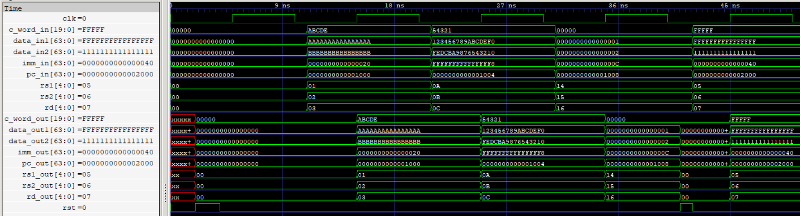

# ID/EX Pipeline Register

The ID/EX pipeline register stores the decoded instruction's datapath operands, program counter, immediate, register indices, and control word between the Instruction Decode (ID) and Execute (EX) stages. It captures all eight fields synchronously on the rising edge of the clock and supports asynchronous reset.

  
   
  ID/EX Pipeline Register

## Features

- 291-bit pipeline register organized into eight independently accessible fields.
- Stores two 64-bit source operands, a 64-bit PC, and a 64-bit immediate.
- Carries the 20-bit control word generated by the Hazard Handling Unit (HHU).
- Stores 5-bit `rs1`, `rs2`, and `rd` register indices for forwarding and dependency tracking.
- Synchronous data capture on the rising edge of the clock.
- Asynchronous active-high reset.
- Independent input and output interfaces for every field.

## Interface

| Signal | Direction | Width | Description |
|---|---|---:|---|
| `data_in1` | Input | 64 bits | First source operand from WIF |
| `data_in2` | Input | 64 bits | Second source operand from WIF |
| `pc_in` | Input | 64 bits | Program counter from IF/ID |
| `imm_in` | Input | 64 bits | Sign-extended immediate from SE |
| `rs1` | Input | 5 bits | First source register index |
| `rs2` | Input | 5 bits | Second source register index |
| `rd` | Input | 5 bits | Destination register index |
| `c_word_in` | Input | 20 bits | Control word from HHU |
| `clk` | Input | 1 bit | Clock signal |
| `rst` | Input | 1 bit | Asynchronous active-high reset |
| `data_out1` | Output | 64 bits | Registered first source operand |
| `data_out2` | Output | 64 bits | Registered second source operand |
| `pc_out` | Output | 64 bits | Registered program counter |
| `imm_out` | Output | 64 bits | Registered immediate |
| `rs1_out` | Output | 5 bits | Registered first source register index |
| `rs2_out` | Output | 5 bits | Registered second source register index |
| `rd_out` | Output | 5 bits | Registered destination register index |
| `c_word_out` | Output | 20 bits | Registered control word |

## Payload Organization

The register stores a total of 291 bits across eight fields.

| Field | Width |
|---|---:|
| Source Operand 1 | 64 bits |
| Source Operand 2 | 64 bits |
| Program Counter | 64 bits |
| Immediate | 64 bits |
| Control Word | 20 bits |
| `rs1` | 5 bits |
| `rs2` | 5 bits |
| `rd` | 5 bits |
| **Total** | **291 bits** |

## Operation

All eight fields are captured together on every rising clock edge.

During asynchronous reset, all registered outputs are cleared to zero without waiting for the next clock edge.

The source operands are supplied by the WB-to-ID Forwarding Unit (WIF), while the control word is supplied by the Hazard Handling Unit (HHU).

The control word carries the datapath control signals and source-usage metadata required by subsequent pipeline stages. When HHU detects a load-use hazard or a taken branch, it can zero the control word to make the corresponding instruction inert.

The register indices are carried independently to support forwarding and dependency tracking in subsequent stages.

## Verification

- RTL simulation: 6 directed test scenarios passed.
- Gate-level simulation: 6 directed test scenarios passed using the synthesized and technology-mapped netlist.
- Asynchronous reset: Verified clearing of all eight fields.
- Sequential capture: Verified simultaneous capture of all fields.
- Operand propagation: Verified both 64-bit source operand paths.
- PC and immediate propagation: Verified 64-bit values.
- Register indices: Verified `rs1`, `rs2`, and `rd` propagation.
- Control propagation: Verified 20-bit control word capture, including a zero control word.
- Reset between clock edges: Verified asynchronous clearing and subsequent capture.
