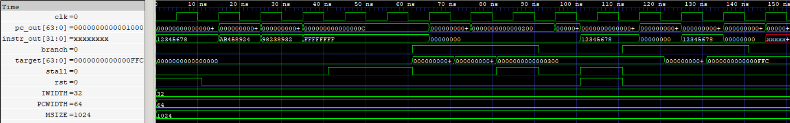

# Instruction Fetch (IF) Stage

The Instruction Fetch (IF) stage combines the Program Counter (PC) and Instruction ROM to provide the current instruction and its corresponding address.

## Features

- Integrates the Program Counter and Instruction ROM.
- Maintains a 64-bit program counter supporting sequential execution and branch redirection.
- Increments the PC by 4 bytes during sequential execution.
- Supports branch redirection through a target-address input.
- Supports stalling to hold the current PC value.
- Loads instruction memory contents from `Program.hex` using `$readmemh`.
- Uses byte-addressed instruction memory, with each 32-bit instruction occupying 4 bytes.

  
   
  RV64I ALU Waveform

## Interface

| Signal      | Direction | Width   | Description                        |
| ----------- | --------- | ------- | ---------------------------------- |
| `clk`       | Input     | 1 bit   | Clock signal                       |
| `rst`       | Input     | 1 bit   | Active-high asynchronous reset     |
| `stall`     | Input     | 1 bit   | Holds the current PC when asserted |
| `branch`    | Input     | 1 bit   | Enables branch redirection         |
| `target`    | Input     | 64 bits | Branch target address              |
| `pc_out`    | Output    | 64 bits | Current program counter            |
| `instr_out` | Output    | 32 bits | Instruction fetched from ROM       |

## PC Control Priority

The PC follows the priority below:

1. Reset: Sets the PC to zero.
2. Stall: Holds the current PC.
3. Branch: Loads the supplied target address.
4. Sequential execution: Increments the PC by 4.

## Instruction Memory

The instruction ROM is parameterized with the following default configuration:

| Parameter | Default | Description                   |
| --------- | ------  | ----------------------------- |
| `MSIZE`   |    1024 | Number of instruction entries |
| `IWIDTH`  | 32 bits | Instruction width             |
| `PCWIDTH` | 64 bits | Program counter width         |

With 1024 entries of 32-bit instructions, the ROM has a capacity of 4096 bytes (4 KiB). The valid instruction-start addresses range from `0x000` through `0xFFC`, in increments of 4 bytes.
Instruction contents are loaded from `Program.hex` using `$readmemh`.

## Verification

- RTL simulation: Verified sequential PC updates, reset behavior, stalling, branch redirection, and instruction fetching.
- Control-priority testing: Verified reset over stall, stall over branch, and branch redirection when higher-priority controls are inactive.
- Boundary testing: Verified PC progression from the last valid instruction address, `0xFFC`, to `0x1000`.
- Gate-level simulation (GLS): Verified PC control behavior using the synthesized and technology-mapped netlist.

Synthesis limitation: In the current synthesis flow, the ROM initialization contents are not preserved in the mapped netlist, and `instr_out` appears as zero during GLS. Therefore, GLS verification covers PC control behavior, while instruction fetching from `Program.hex` is verified through RTL simulation.
