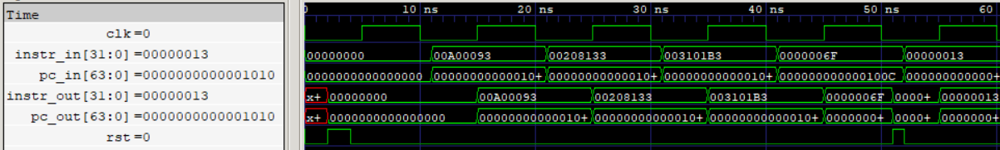

# IF/ID Pipeline Register

The IF/ID pipeline register stores the program counter and fetched instruction between the Instruction Fetch (IF) and Instruction Decode (ID) stages. It captures both values synchronously on the rising edge of the clock and supports asynchronous reset.

  

## Features

- Parameterized instruction and program counter widths.
- Stores a 32-bit instruction and 64-bit program counter by default.
- Synchronous data capture on the rising clock edge.
- Asynchronous active-high reset.
- Independent instruction and PC input/output interfaces.

## Interface

| Signal | Direction | Width | Description |
|---|---|---|---|
| `instr_in` | Input | IWIDTH | Instruction from the BHU output |
| `pc_in` | Input | PCWIDTH | Program counter from the IF stage |
| `clk` | Input | 1 | Clock signal |
| `rst` | Input | 1 | Asynchronous active-high reset |
| `instr_out` | Output | IWIDTH | Registered instruction delivered to ID |
| `pc_out` | Output | PCWIDTH | Registered program counter delivered to ID |

## Operation

The register captures the instruction and corresponding program counter together on every rising clock edge.

During reset, both outputs are asynchronously cleared to zero.

The instruction input is connected to the BHU's `if_id_out` signal, allowing the register to receive either the fetched instruction or an injected NOP when a branch or jump is taken.

## Verification

- 5 directed test cases performed.
- Verified asynchronous reset assertion and deassertion.
- Verified simultaneous PC and instruction capture.
- Verified sequential instruction capture.
- Verified reset between clock edges.
- RTL simulation and Gate-Level Simulation (GLS) completed successfully.
