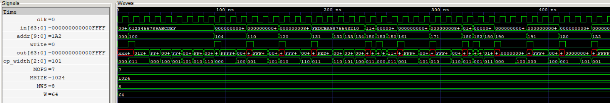

# Memory (MEM) Stage
A parameterized 1 KiB byte-addressable memory supporting 8-bit, 16-bit, 32-bit, and 64-bit accesses. It provides combinational reads and synchronous writes, with support for both aligned and misaligned accesses. The memory follows little-endian byte ordering and supports signed and unsigned load operations.

  
   
  MEM Waveform

## Features
- Parameterized memory size, memory word size, and data width
- Byte-addressable memory organization
- Combinational asynchronous reads
- Synchronous writes on the positive clock edge
- Supports byte, halfword, word, and doubleword accesses
- Supports aligned and misaligned memory accesses
- Little-endian byte ordering
- Signed loads: LB, LH, LW
- Unsigned loads: LBU, LHU, LWU
- Store operations: SB, SH, SW, SD
- Partial writes preserve unaffected memory bytes
- Sign extension and zero extension for load operations
