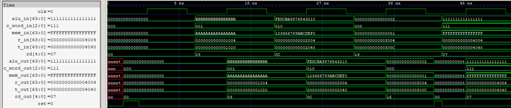

# MEM/WB Pipeline Register

The MEM/WB pipeline register stores the memory read result, ALU result, TAG outputs, destination register index, and writeback control signals between the Memory (MEM) and Writeback (WB) stages. It captures all six fields synchronously on the rising edge of the clock and supports asynchronous reset.

  
   
  MEM/WB Pipeline Register

## Features

- 264-bit pipeline register organized into six independently accessible fields.
- Stores a 64-bit memory read result and a 64-bit ALU result.
- Carries the 64-bit TAG return address (`r_out`) and target address (`t_out`).
- Carries a 3-bit control word containing the writeback selection and register-file write enable signals.
- Stores the 5-bit `rd` destination register index for register-file writeback and forwarding.
- Synchronous data capture on the rising edge of the clock.
- Asynchronous active-high reset.
- Independent input and output interfaces for every field.

## Interface

| Signal | Direction | Width | Description |
|---|---|---:|---|
| `mem_in` | Input | 64 bits | Memory read result from RAM |
| `alu_in` | Input | 64 bits | ALU result from EX/MEM |
| `r_in` | Input | 64 bits | TAG return address from EX/MEM |
| `t_in` | Input | 64 bits | TAG target address from EX/MEM |
| `c_word_in` | Input | 3 bits | Writeback control word |
| `rd` | Input | 5 bits | Destination register index |
| `clk` | Input | 1 bit | Clock signal |
| `rst` | Input | 1 bit | Asynchronous active-high reset |
| `mem_out` | Output | 64 bits | Registered memory read result |
| `alu_out` | Output | 64 bits | Registered ALU result |
| `r_out` | Output | 64 bits | Registered return address |
| `t_out` | Output | 64 bits | Registered target address |
| `c_word_out` | Output | 3 bits | Registered writeback control word |
| `rd_out` | Output | 5 bits | Registered destination register index |

## Payload Organization

The register stores a total of 264 bits across six fields.

| Field | Width |
|---|---:|
| Memory Read Result | 64 bits |
| ALU Result | 64 bits |
| TAG Return Address | 64 bits |
| TAG Target Address | 64 bits |
| Control Word | 3 bits |
| `rd` | 5 bits |
| **Total** | **264 bits** |

## Operation

All six fields are captured together on every rising clock edge.

During asynchronous reset, all registered outputs are cleared to zero without waiting for the next clock edge.

The memory read result, ALU result, and TAG outputs carry the possible writeback values from the preceding pipeline stages.

The 3-bit control word carries the writeback selection (`res[1:0]`) and register-file write enable (`write_rf`) signals required by the WB stage.

The `rd` register index identifies the destination register for writeback and is also retained for WB-to-ID forwarding and dependency tracking.

## Verification

- RTL simulation: Directed test scenarios passed.
- Gate-level simulation: Directed test scenarios passed using the synthesized and technology-mapped netlist.
- Asynchronous reset: Verified clearing of all six fields.
- Sequential capture: Verified simultaneous capture of all fields.
- Memory result propagation: Verified 64-bit memory result capture.
- ALU result propagation: Verified 64-bit ALU result capture.
- TAG propagation: Verified return address and target address capture.
- Control propagation: Verified 3-bit control word capture, including a zero control word.
- Destination register index: Verified `rd` propagation.
- Reset between clock edges: Verified asynchronous clearing and subsequent capture.
