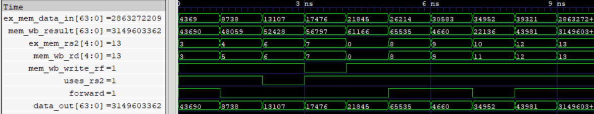

# MEM-to-MEM Forwarding (MMF) Unit

The MEM-to-MEM Forwarding (MMF) unit resolves Read-After-Write (RAW) data dependencies between load and store instructions in the five-stage pipeline.

When a load instruction produces a value that a subsequent store instruction needs to write to memory, the loaded value may not yet be available in the register file. The MMF unit detects this dependency by comparing the store instruction's `rs2` source register with the destination register of the instruction in MEM/WB.

When a dependency is detected, MMF forwards the MEM/WB result directly to the RAM write-data input, avoiding the need to wait for register-file write-back.

<p align="center">
  
  <br>
  <sub>MEM-to-MEM Forwarding</sub>
</p>

## Features

- Detects RAW dependencies between load results and store data operands.
- Compares the store's `rs2` register index against the MEM/WB destination register.
- Uses `uses_rs2` metadata to qualify source-register comparisons.
- Prevents forwarding from the zero register (`x0`).
- Qualifies forwarding using the MEM/WB register-file write control.
- Forwards loaded or computed results directly to the RAM write-data input.
- Preserves original store data when no forwarding condition is satisfied.
- Implements combinational forwarding logic without additional pipeline latency.

## Interface

| Signal | Direction | Width | Description |
|---|---|---|---|
| `ex_mem_data_in` | Input | 64 bits | Original store data from EX/MEM |
| `mem_wb_rd` | Input | 5 bits | Destination register index from MEM/WB |
| `ex_mem_rs2` | Input | 5 bits | Store instruction's second source register index from EX/MEM |
| `mem_wb_result` | Input | 64 bits | Result available in MEM/WB |
| `mem_wb_write_rf` | Input | 1 bit | MEM/WB register-file write control |
| `uses_rs2` | Input | 1 bit | Indicates whether the store instruction uses rs2 |
| `data_out` | Output | 64 bits | Store data after forwarding selection |

## Forwarding Logic

The MMF unit compares the store instruction's `rs2` register index against the destination register index in MEM/WB.

A forwarding condition is asserted when:

- The store instruction uses `rs2`.
- The `rs2` register index matches `mem_wb_rd`.
- The destination register is not `x0`.
- The MEM/WB instruction enables register-file write-back.

The forwarding condition is:

```systemverilog
forward = (mem_wb_rd == ex_mem_rs2) &&
          (mem_wb_write_rf) &&
          (mem_wb_rd != 0) &&
          (uses_rs2);
```

The forwarding decision controls the store-data selection:

```systemverilog
data_out = forward ? mem_wb_result : ex_mem_data_in;
```

If a dependency is detected, the MEM/WB result is forwarded directly to the RAM write-data input. Otherwise, the original store data from EX/MEM is selected.

### Load-to-Store Dependency

Consider the following instruction sequence:

```asm
lw s3, 12(s0)
sw s3, 10(s0)
```

The load instruction writes its result into `s3`, while the subsequent store instruction requires `s3` as its store-data operand.

When the store reaches MEM, the loaded value is available in MEM/WB. MMF detects the register dependency and forwards the loaded value directly to RAM, ensuring that the correct data is stored.

## Verification

- RTL simulation: 10 directed test vectors verified.
- Gate-level simulation: 10 directed test vectors verified using the synthesized and technology-mapped netlist.
- Dependency detection: Verified matching and non-matching `rs2` and `rd` register indices.
- Source qualification: Verified that `uses_rs2` prevents forwarding when the source register is unused.
- Zero-register handling: Verified that forwarding from `x0` is prevented.
- Write qualification: Verified that forwarding is disabled when `mem_wb_write_rf` is deasserted.
- Data selection: Verified MEM/WB result forwarding and original store-data pass-through.
