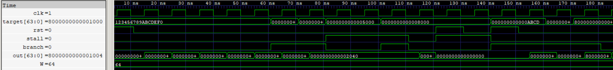

# Program Counter (PC)

A 64-bit program counter that maintains the address of the current instruction. It increments the PC by 4 during sequential execution, loads a branch target when redirection is requested, and holds its value when stalled. An active-high asynchronous reset clears the PC to zero.

## Features

- Active-high asynchronous reset
- Sequential address increment (`PC + 4`)
- Branch redirection using a target address input
- Stall support to hold the current PC
- Stall takes priority over branch redirection
- Supports 64-bit instruction addresses

  
   
  Program Counter

## Verification

- Directed manual tests passed.
- 10,000 randomized RTL test vectors passed with zero failures.
- Directed gate-level simulation (GLS) passed.
- 10,000 randomized GLS test vectors passed with zero failures.

The verification covers asynchronous reset, sequential increment, branch redirection, stall behavior, stall-versus-branch priority, and 64-bit address handling.
