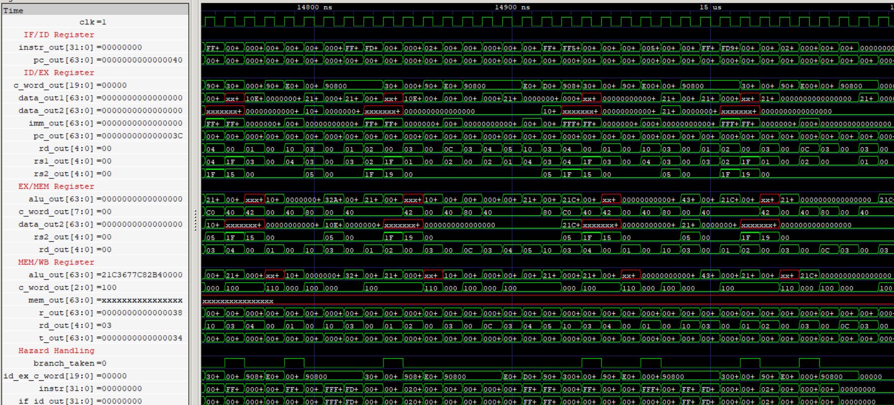

# RV64I Pipelined Processor
A 64-bit processor implementing a documented subset of the RV64I Base ISA through a five-stage, in-order pipeline.

## 🛠️ Tools & Technologies
-3949AB?style=flat-square)

## 📚 Documentation
- [Instruction Set Architecture](ISA.md)

## ⚙️ Supported Instructions

> 49 of 52 RV64I Base ISA instructions implemented

| Category | Instructions |
|---|---|
| Upper Immediate | `LUI`, `AUIPC` |
| Control Transfer | `JAL`, `JALR` |
| Conditional Branch | `BEQ`, `BNE`, `BLT`, `BGE`, `BLTU`, `BGEU` |
| Loads | `LB`, `LH`, `LW`, `LD`, `LBU`, `LHU`, `LWU` |
| Stores | `SB`, `SH`, `SW`, `SD` |
| Immediate Arithmetic & Logic | `ADDI`, `SLTI`, `SLTIU`, `XORI`, `ORI`, `ANDI` |
| Immediate Shifts | `SLLI`, `SRLI`, `SRAI` |
| Register Arithmetic & Logic | `ADD`, `SUB`, `SLL`, `SLT`, `SLTU`, `XOR`, `SRL`, `SRA`, `OR`, `AND` |
| Word Immediate Operations | `ADDIW`, `SLLIW`, `SRLIW`, `SRAIW` |
| Word Register Operations | `ADDW`, `SUBW`, `SLLW`, `SRLW`, `SRAW` |

## 🧮 Factorial

This program computes the factorial of 20 (`20!`) using the RV64I instruction set, exercising arithmetic operations, loop execution, conditional branching, and pipeline control-flow handling.

**Program Source:** [Factorial.hex](CORE/Programs/Factorial.hex)

> The waveform captures the five-stage pipeline during factorial execution. It illustrates instruction flow through the pipeline and branch-handling behavior, including control-word and IF/ID updates when a branch is taken.

`[20! = 2,432,902,008,176,640,000]`

  
   
  RTL simulation of the processor executing the Factorial (20!) program, illustrating pipeline-register activity, datapath execution, and branch handling.

**Performance:** The processor executed the Factorial (20!) program in **1,510 clock cycles**, retiring 1,255 instructions, achieving a **CPI of 1.20319** and an **IPC of 0.83113**. The execution involved 251 branch flush events and no stall cycles.

## ⚙️ Implemented Modules

| Module               | Description                                                       | Status |
| -------------------- | ------------------------------------------------------------------| ------ |
| [RF](RF) | Stores operands and intermediate results during program execution | ✅     |
| [SE](SE) | Extracts, reconstructs, and extends RV64I instruction immediates to 64 bits | ✅      |
| [PC](PC) | Maintains the current address and selects sequential or branch addresses | ✅      |
| [ROM](ROM) | Stores and fetches 32-bit instructions using the PC's byte address | ✅ |
| [ALU](ALU) | Performs arithmetic, logical, shift operations and generates comparision signals | ✅ |
| [TAG](TAG) | Calculates branch and jump targets and generates return addresses | ✅      |
| [RAM](RAM) | implements byte-addressable memory with support for aligned and misaligned accesses | ✅ |
| [CU](CU) | decodes 49 RV64I instructions and generates datapath control signals | ✅ |
| [EEF](EEF) | Detects EX/MEM-to-EX RAW dependencies and forwards results to ALU operands | ✅ |
| [MEF](MEF) | Detects MEM/WB-to-EX RAW dependencies and forwards results to ALU operands | ✅ |
| [EFU](EFU) | Integrates EEF and MEF, forwarding ALU operands with EX/MEM priority over MEM/WB | ✅ |
| [MMF](MMF) | Detects MEM/WB-to-MEM RAW dependencies and forwards results to RAM data input | ✅ |
| [WIF](WIF) | Detects MEM/WB-to-ID RAW dependencies and forwards results to IF/ID data input | ✅ |
| [HDU](HDU) | Detects load-use RAW hazards, stalls the pipeline, and inserts bubbles | ✅ |
| [BCU](BCU) | Determines whether branches and unconditional jumps should redirect program execution | ✅ |
| [BHU](BHU) | Handles pipeline flushing by injecting NOPs when branches or jumps are taken | ✅ |
| [HHU](HHU) | Integrates HDU and BHU to handle load-use and control hazards through stalls and flushes | ✅ |
| [IFID](IFID) | 96-bit pipeline register carrying PC and instruction between IF and ID | ✅ |
| [IDEX](IDEX) | 291-bit pipeline register carrying operands, control signals, metadata between ID and EX | ✅ |
| [EXMEM](EXMEM) | 274-bit pipeline register carrying execution results, forwarding data between EX and MEM | ✅ |
| [MEMWB](MEMWB) | 264-bit pipeline register carrying memory, execution, writeback data between MEM and WB | ✅ |
| [CORE](CORE) | Integrated 64-bit pipelined processor with forwarding and hazard handling | ✅ |

## 🔄 Implemented Pipeline Stages
| Stage | Description                                                                              | Status |
| ----- | ---------------------------------------------------------------------------------------- | ------ |
| [IF](IF)    | Integrates PC and ROM to fetch instructions and their addresses                          | ✅     |
| [ID](ID)    | Integrates RF, SE, and CU to read operands, generate immediates, and decode instructions | ✅     |
| [EX](EX)    | Integrates ALU and TAG to perform operations and calculate target addresses              | ✅     |
| [MEM](MEM)  | Integrates the data memory for load/store operations                                     | ✅     |
| [WB](WB)    | Selects the appropriate result for register write-back                                   | ✅     |

## 📜License
- Source code and HDL files are licensed under the MIT License.
- Documentation, diagrams, images, and PDFs are licensed under Creative Commons Attribution 4.0 (CC BY 4.0).
