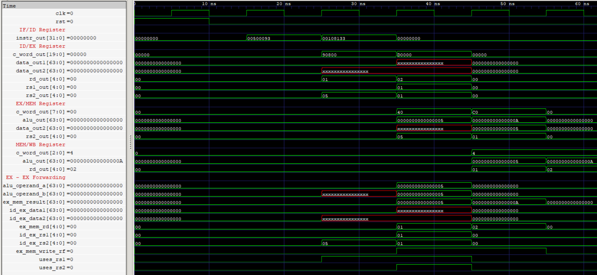
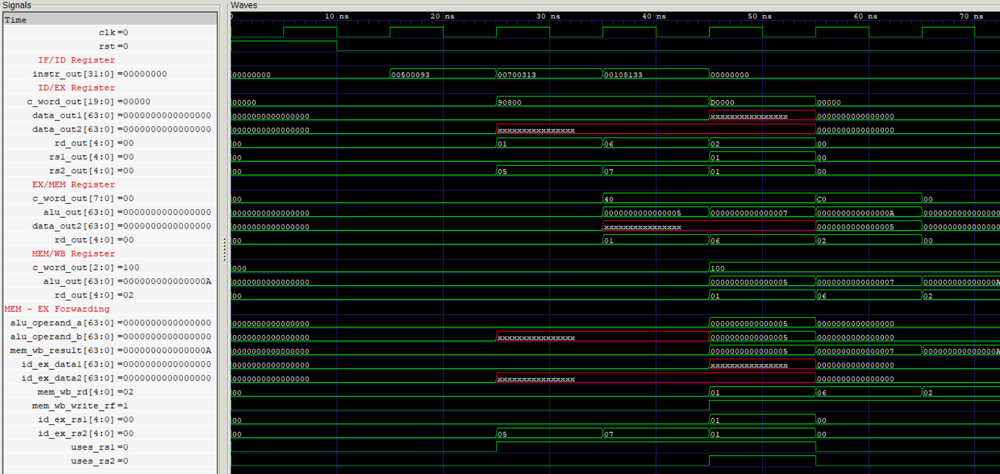
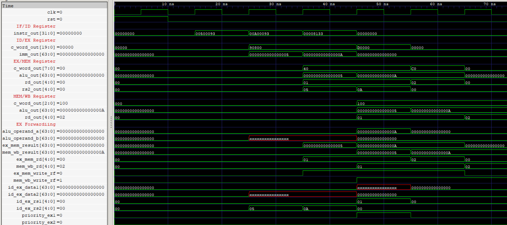
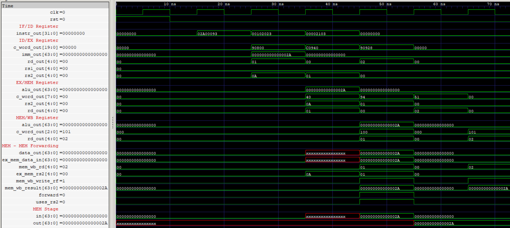
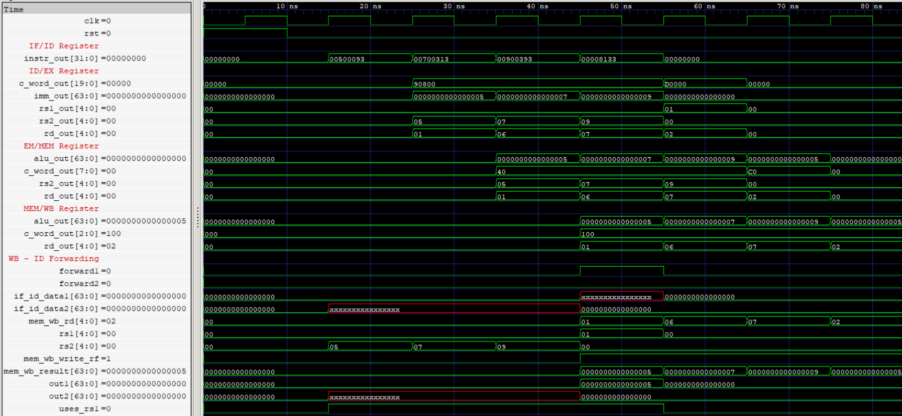
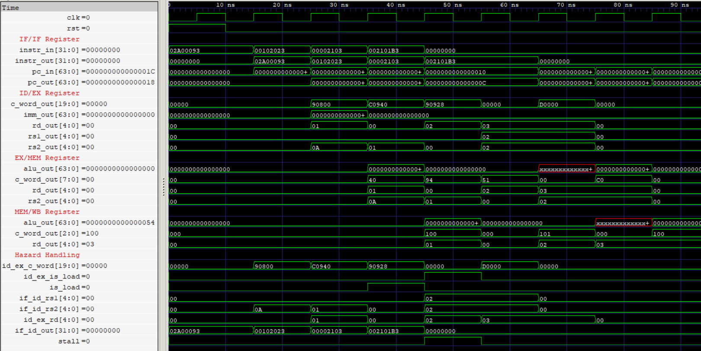
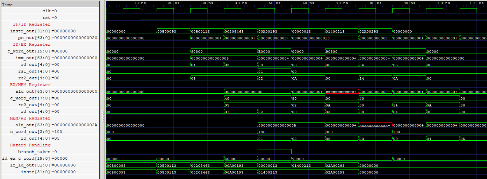
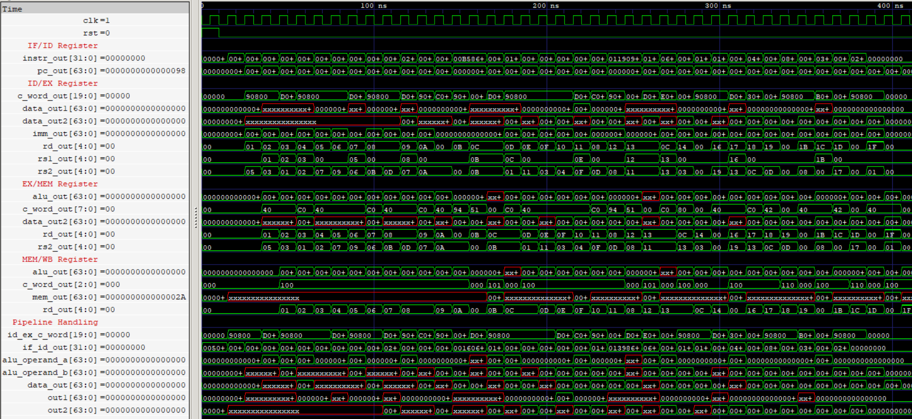

# RV64I Pipelined Processor
The processor follows a **five-stage, in-order pipeline architecture** (IF, ID, EX, MEM, WB), implementing a documented subset of the **RV64I Base Integer ISA**. It incorporates dedicated hazard handling, data forwarding paths, pipeline stalling, and control-flow redirection to manage instruction dependencies and execution flow.

## 🛠️ Tools & Technologies
-3949AB?style=flat-square)


## 📚 Documentation
- [Instruction Set Architecture](ISA.md)

## ↗️ EX/MEM → EX Forwarding

This test verifies EX/MEM-to-EX data forwarding by executing consecutive dependent instructions, handling RAW dependencies with a dependency distance of 1, where the second instruction consumes the result produced by the preceding instruction.

`EX_MEM-EX.asm`

```asm
        ADDI x1, x0, 5      ; Initialize x1 = 5
        ADD  x2, x1, x1     ; x2 = x1 + x1
```

**Program Source:** [EX_MEM-EX.hex](CORE/Programs/EX_MEM-EX.hex)

> The waveform captures the forwarding operation, where the result (`5`) from the EX/MEM pipeline register is routed to both ALU operands of the dependent ADD instruction, producing the expected result (`10`) without stalling the pipeline.

`[x1 = 0x05(5), x2 = 0x0A(10)]`

<p align="center">
  
  <br>
  <sub>RTL simulation demonstrating EX/MEM-to-EX forwarding through the ALU operand selection and execution datapath.</sub>
</p>

## ↗️ MEM/WB → EX Forwarding

This test verifies MEM/WB-to-EX data forwarding by executing dependent instructions separated by one independent instruction, handling RAW dependencies with a dependency distance of 2.

`MEM_WB-EX.asm`

```asm
        ADDI x1, x0, 5      ; Initialize x1 = 5
        ADDI x6, x0, 7      ; Independent instruction
        ADD  x2, x1, x1     ; x2 = x1 + x1
```

**Program Source:** [MEM_WB-EX.hex](CORE/Programs/MEM_WB-EX.hex)

> The waveform captures the MEM/WB-to-EX forwarding operation, where the result (`5`) produced by the first ADDI instruction is forwarded to both ALU operands of the dependent ADD instruction, producing `10`.

`[x1 = 0x05(5), x2 = 0x0A(10), x6 = 0x07(7)]`

<p align="center">
  
  <br>
  <sub>RTL simulation demonstrating MEM/WB-to-EX forwarding through the ALU operand selection and execution datapath.</sub>
</p>

## ↗️ EX/MEM Forwarding Priority

This test verifies forwarding priority resolution when both EX/MEM and MEM/WB contain pending results for the same destination register. The forwarding unit must prioritize the newer EX/MEM result over the older MEM/WB result.

`EX_MEM-EX_Priority.asm`

```asm
        ADDI x1, x0, 5      ; Initialize x1 = 5
        ADDI x1, x0, 10     ; Update x1 = 10
        ADD  x2, x1, x0     ; x2 = x1 (must receive 10)
```

**Program Source:** [EX_MEM-EX_Priority.hex](CORE/Programs/EX_MEM-EX_Priority.hex)

> The waveform captures the simultaneous forwarding matches, demonstrating that the EX/MEM path takes priority and supplies the newer value (`10`) to the dependent ADD instruction instead of the older MEM/WB value (`5`).

`[x1 = 0x0A(10), x2 = 0x0A(10)]`

<p align="center">
  
  <br>
  <sub>RTL simulation demonstrating EX/MEM forwarding priority over MEM/WB when both paths match the same source register.</sub>
</p>

## ↗️ MEM/WB → MEM Forwarding

This test verifies MEM/WB-to-MEM data forwarding, where a result produced by an earlier instruction is forwarded from the MEM/WB pipeline register when it is needed as store data in the MEM stage.

`MEM_WB-MEM.asm`

```asm
        ADDI x1, x0, 42     ; Initialize x1 = 42
        SW   x1, 0(x0)      ; Store x1 to memory address 0
        LW   x2, 0(x0)      ; Load stored value into x2
```

**Program Source:** [MEM_WB-MEM.hex](CORE/Programs/MEM_WB-MEM.hex)

> The waveform captures MEM/WB-to-MEM forwarding, demonstrating how a result available in the MEM/WB register is supplied to a dependent store instruction in the MEM stage.

`[x1 = 0x2A(42), MEM[0] = 0x2A(42), x2 = 0x2A(42)]`

<p align="center">
  
  <br>
  <sub>RTL simulation demonstrating MEM/WB-to-MEM store-data forwarding and subsequent memory readback.</sub>
</p>

## ↗️ MEM/WB → ID Forwarding

This test verifies MEM/WB-to-ID data forwarding, where a result available in the MEM/WB pipeline register is forwarded to the ID-stage operand path when a dependent instruction requires it. The test exercises a RAW dependency with a dependency distance of 3.

`MEM_WB-ID.asm`

```asm
        ADDI x1, x0, 5      ; Initialize x1 = 5
        ADDI x6, x0, 7      ; Independent instruction
        ADDI x7, x0, 9      ; Independent instruction
        ADD  x2, x1, x0     ; x2 = x1
```

**Program Source:** [MEM_WB-ID.hex](CORE/Programs/MEM_WB-ID.hex)

> The waveform captures MEM/WB-to-ID forwarding, demonstrating how the updated value (`5`) is supplied directly to the dependent instruction's ID-stage operand path.

`[x1 = 0x05(5), x2 = 0x05(5), x6 = 0x07(7), x7 = 0x09(9)]`

<p align="center">
  
  <br>
  <sub>RTL simulation demonstrating MEM/WB-to-ID forwarding through the decode-stage operand path.</sub>
</p>

**Design Consideration:** The register file does not rely on negative-edge write/read timing to resolve same-cycle dependencies. Instead, an explicit MEM/WB-to-ID forwarding path supplies the pending writeback value. This avoids introducing half-cycle timing paths between opposite clock edges, which would reduce the available timing budget and impose additional setup/hold constraints. Any timing violations can compromise reliable operation; explicit forwarding keeps the dependency handling within the pipeline's intended clocking scheme.

## ⚠️ Load-Use Hazard - Pipeline Stalling

This test verifies load-use hazard detection by executing an instruction that immediately consumes data loaded from memory, requiring the Hazard Handling Unit (HHU) to stall the pipeline until the data becomes available.

`Load_Use.asm`

```asm
        ADDI x1, x0, 42     ; Initialize x1 = 42
        SW   x1, 0(x0)      ; Store 42 at memory address 0
        LW   x2, 0(x0)      ; Load value from memory
        ADD  x3, x2, x2     ; Immediately consume loaded value
```

**Program Source:** [Load_Use.hex](CORE/Programs/Load_Use.hex)

> The waveform captures the load-use dependency, demonstrating HHU stall assertion and pipeline control while the load instruction progresses to make its result available to the dependent ADD instruction.

`[MEM[0] = 0x2A(42), x2 = 0x2A(42), x3 = 0x54(84)]`

<p align="center">
  
  <br>
  <sub>RTL simulation demonstrating load-use hazard detection, pipeline stalling, and subsequent data forwarding.</sub>
</p>

## 🔀 Branch Handling - Pipeline Flush

This test verifies control-flow redirection when a branch is taken. Since branch resolution occurs in the EX stage, the two younger instructions occupying the IF and ID stages must be flushed, and execution must continue from the branch target.

**Branch_Flush.asm**
```asm
        ADDI x1, x0, 5      ; Initialize x1 = 5
        ADDI x2, x0, 5      ; Initialize x2 = 5
        BEQ  x1, x2, TARGET ; Branch if x1 == x2

        ADDI x3, x0, 10     ; Wrong-path instruction (must be flushed)
        ADDI x4, x0, 20     ; Wrong-path instruction (must be flushed)

TARGET:
        ADDI x5, x0, 42     ; Execute branch target
```

**Program Source:** [Branch_Flush.hex](CORE/Programs/Branch_Flush.hex)

> The waveform demonstrates a taken branch resolved in the EX stage, invalidating the two younger instructions in the IF and ID stages. The PC is redirected to the branch target, where execution resumes.

**Expected Result:** `[x1 = 0x05(5), x2 = 0x05(5), x5 = 0x2A(42)]`

The instructions writing to `x3` and `x4` must not execute.

<p align="center">
  
  <br>
  <sub>RTL simulation waveform showing branch resolution, pipeline flush, and execution at the branch target.</sub>
</p>

## 🔗 Integrated Pipeline Test

This test evaluates the processor's pipeline behavior under a continuous instruction stream combining data dependencies, forwarding, load-use hazards, pipeline stalls, and control-flow redirection. It exercises the forwarding paths and hazard-handling mechanisms through interacting instruction sequences, including conditional branches, JAL, and JALR.

**Integrated_Test.asm**
```asm
        ADDI x1, x0, 5
        ADDI x2, x1, 3
        ADD  x3, x2, x1
        ADDI x4, x3, 2

        ADDI x5, x0, 7
        ADDI x6, x0, 9
        ADD  x7, x5, x6

        ADDI x8, x0, 11
        ADDI x8, x0, 13
        ADD  x9, x8, x7

        ADDI x10, x0, 42
        SW   x10, 0(x0)
        LW   x11, 0(x0)
        ADD  x12, x11, x11
        ADDI x13, x12, 1

        ADDI x14, x0, 17
        ADDI x15, x0, 3
        ADDI x16, x0, 4
        ADD  x17, x14, x15

        SW   x13, 8(x0)
        LW   x18, 8(x0)
        ADD  x19, x18, x17

        BEQ  x19, x19, BRANCH_TARGET
        ADDI x20, x0, 99
        ADDI x21, x0, 88

BRANCH_TARGET:
        ADDI x22, x0, 25
        ADD  x23, x22, x19

        JAL  x24, JAL_TARGET
        ADDI x25, x0, 77
        ADDI x26, x0, 66

JAL_TARGET:
        ADDI x27, x0, 136
        JALR x28, 0(x27)

        ADDI x29, x0, 55
        ADDI x30, x0, 44

JALR_TARGET:
        ADDI x31, x0, 33
```

**Program Source:** [Integrated_Test.hex](CORE/Programs/Integrated_Test.hex)

> The waveform demonstrates the interaction of data forwarding, load-use hazard detection, pipeline stalling, and control-flow redirection within a continuous instruction stream. Taken BEQ, JAL, and JALR instructions redirect execution while invalidating younger instructions in the pipeline.

**Expected Result:**

- Register values:

```text
x1  = 0x05(5)       x2  = 0x08(8)
x3  = 0x0D(13)      x4  = 0x0F(15)
x5  = 0x07(7)       x6  = 0x09(9)
x7  = 0x10(16)      x8  = 0x0D(13)
x9  = 0x1D(29)      x10 = 0x2A(42)
x11 = 0x2A(42)      x12 = 0x54(84)
x13 = 0x55(85)      x14 = 0x11(17)
x15 = 0x03(3)       x16 = 0x04(4)
x17 = 0x14(20)      x18 = 0x55(85)
x19 = 0x69(105)     x22 = 0x19(25)
x23 = 0x82(130)     x24 = 0x70(112)
x27 = 0x88(136)     x28 = 0x80(128)
x31 = 0x21(33)
```

- Memory values: `[MEM[0] = 0x2A(42), MEM[8] = 0x55(85)]`
- Flushed instructions: writes to `x20`, `x21`, `x25`, `x26`, `x29`, and `x30` must not occur.
- `x0` remains architecturally zero.

<p align="center">
  
  <br>
  <sub>RTL simulation waveform showing integrated pipeline execution, data forwarding, load-use stalls, and control-flow redirection.</sub>
</p>

## ⚙️ Implemented Modules

| Module               | Description                                                       | Status |
| -------------------- | ------------------------------------------------------------------| ------ |
| [RF](RF) | Stores operands and intermediate results during program execution | ✅     |
| [SE](SE) | Extracts, reconstructs, and extends RV64I instruction immediates to 64 bits | ✅      |
| [PC](PC) | Maintains the current address and selects sequential or branch addresses | ✅      |
| [ROM](ROM) | Stores and fetches 32-bit instructions using the PC's byte address | ✅ |
| [ALU](ALU) | Performs arithmetic, logical, shift operations and generates comparision signals | ✅ |
| [TAG](TAG) | Calculates branch and jump targets and generates return addresses | ✅      |
| [RAM](MEM) | implements byte-addressable memory with support for aligned and misaligned accesses | ✅ |
| [CU](CU) | decodes 49 RV64I instructions and generates datapath control signals | ✅ |
| [EEF](EEF) | Detects EX/MEM-to-EX RAW dependencies and forwards results to ALU operands | ✅ |
| [MEF](MEF) | Detects MEM/WB-to-EX RAW dependencies and forwards results to ALU operands | ✅ |
| [EFU](EFU) | Integrates EEF and MEF, forwarding ALU operands with EX/MEM priority over MEM/WB | ✅ |
| [MMF](MMF) | Detects MEM/WB-to-MEM RAW dependencies and forwards results to RAM data input | ✅ |
| [WIF](WIF) | Detects MEM/WB-to-ID RAW dependencies and forwards results to IF/ID data input | ✅ |
| [HDU](HDU) | Detects load-use RAW hazards, stalls the pipeline, and inserts bubbles | ✅ |
| [BCU](BCU) | Determines whether branches and unconditional jumps should redirect program execution | ✅ |
| [BHU](BHU) | Handles pipeline flushing by injecting NOPs when branches or jumps are taken | ✅ |
| [HHU](HHU) | Integrates HDU and BHU to handle load-use and control hazards through stalls and flushes | ✅ |
| [IFID](IFID) | 96-bit pipeline register carrying PC and instruction between IF and ID | ✅ |
| [IDEX](IDEX) | 291-bit pipeline register carrying operands, control signals, metadata between ID and EX | ✅ |
| [EXMEM](EXMEM) | 274-bit pipeline register carrying execution results, forwarding data between EX and MEM | ✅ |
| [MEMWB](MEMWB) | 264-bit pipeline register carrying memory, execution, writeback data between MEM and WB | ✅ |
| [CORE](CORE) | Integrated 64-bit pipelined processor with forwarding and hazard handling | ✅ |

## 🔄 Implemented Pipeline Stages
| Stage | Description                                                                              | Status |
| ----- | ---------------------------------------------------------------------------------------- | ------ |
| [IF](IF)    | Integrates PC and ROM to fetch instructions and their addresses                          | ✅     |
| [ID](ID)    | Integrates RF, SE, and CU to read operands, generate immediates, and decode instructions | ✅     |
| [EX](EX)    | Integrates ALU and TAG to perform operations and calculate target addresses              | ✅     |
| [MEM](MEM)  | Integrates the data memory for load/store operations                                     | ✅     |
| [WB](WB)    | Selects the appropriate result for register write-back                                   | ✅     |

## ⚙️ Supported Instructions

> 49 of 52 RV64I Base ISA instructions implemented

| Category | Instructions |
|---|---|
| Upper Immediate | `LUI`, `AUIPC` |
| Control Transfer | `JAL`, `JALR` |
| Conditional Branch | `BEQ`, `BNE`, `BLT`, `BGE`, `BLTU`, `BGEU` |
| Loads | `LB`, `LH`, `LW`, `LD`, `LBU`, `LHU`, `LWU` |
| Stores | `SB`, `SH`, `SW`, `SD` |
| Immediate Arithmetic & Logic | `ADDI`, `SLTI`, `SLTIU`, `XORI`, `ORI`, `ANDI` |
| Immediate Shifts | `SLLI`, `SRLI`, `SRAI` |
| Register Arithmetic & Logic | `ADD`, `SUB`, `SLL`, `SLT`, `SLTU`, `XOR`, `SRL`, `SRA`, `OR`, `AND` |
| Word Immediate Operations | `ADDIW`, `SLLIW`, `SRLIW`, `SRAIW` |
| Word Register Operations | `ADDW`, `SUBW`, `SLLW`, `SRLW`, `SRAW` |

## 📜License
- Source code and HDL files are licensed under the MIT License.
- Documentation, diagrams, images, and PDFs are licensed under Creative Commons Attribution 4.0 (CC BY 4.0).
