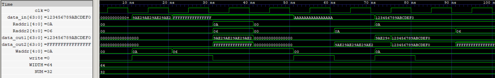

# Register File (RF)

A parameterized 64-bit register file containing 32 registers with two asynchronous read ports and one synchronous write port. Register `x0` is hardwired to zero, and writes to it are discarded.

## Features

- Parameterized register width and number of registers
- Two independent combinational read ports
- Synchronous writes on the active clock edge
- Hardwired zero register (`x0`)
- Holds stored values when no write occurs
- Supports simultaneous reads from two registers

  
   
  Register File

