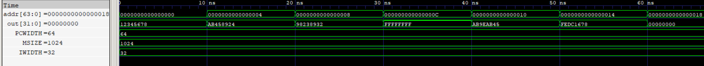

# Instruction Memory (ROM)

A parameterized, combinational instruction memory for the RV64I pipelined processor. The ROM stores 32-bit instructions and accepts a 64-bit byte address from the Program Counter (PC). The byte address is converted to a word index by shifting right by two bits, allowing each aligned address to select one instruction.

The functional implementation initializes the memory to zero and loads instruction contents from `Program.hex` using `$readmemh`. 

## Features

- Parameterized memory depth, instruction width, and PC address width
- 32-bit instruction output
- 64-bit byte-address input
- Word-index mapping using `addr >> 2`
- Asynchronous combinational instruction reads
- Instruction initialization using `$readmemh`
- Supports 1,024 instruction words (4 KiB) by default

  
   
  Instruction Memory RTL Simulation

