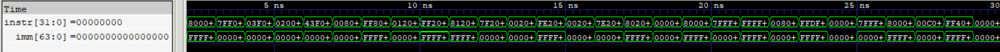

# Sign Extender (SE)

The Sign Extender is a combinational RTL module that extracts and reconstructs immediates from RV64I instruction encodings. It supports I-type, S-type, B-type, U-type, and J-type immediates, including the special handling required for 64-bit shift instructions.

## Features

- Supports I, S, B, U, and J instruction formats.
- Reconstructs immediate values from their encoded instruction bit positions.
- Sign-extends immediates to 64 bits where required.
- Zero-extends the 6-bit shift amount for SLLI, SRLI, and SRAI.
- Outputs zero for unsupported instruction opcodes.
- Verified using directed test cases covering positive and negative immediates, boundary values, and immediate-field reconstruction.

  
   
  <em>RTL simulation waveform showing immediate reconstruction and sign/zero extension.</em>

