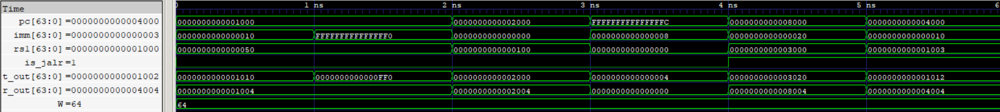

# Target Address Generator (TAG)

The Target Address Generator is a combinational RTL module for calculating branch and jump target addresses in the RV64I pipelined processor. It supports PC-relative targets for branches and `JAL`, register-relative targets for `JALR`, and return-address generation for jump instructions.

  
   
  TAG Waveform

## Features

- Calculates branch and `JAL` targets using `PC + immediate`.
- Calculates `JALR` targets using `(rs1 + immediate) & ~64'd1`.
- Selects between the PC and the `rs1` register value using the `is_jalr` control signal.
- Generates the return address using `PC + 64'd4`.

## Interface

| Signal    | Direction | Width   | Description                                        |
| --------- | --------- | ------- | -------------------------------------------------- |
| `rs1`     | Input     | 64 bits | Source-register value used for `JALR`              |
| `imm`     | Input     | 64 bits | Sign-extended instruction immediate                |
| `pc`      | Input     | 64 bits | Address of the instruction being executed          |
| `is_jalr` | Input     | 1 bit   | Selects `rs1` as the target-address base when high |
| `t_out`   | Output    | 64 bits | Calculated branch or jump target                   |
| `r_out`   | Output    | 64 bits | Return address (`PC + 4`)                          |

## Target Address Calculations

| Instruction          | Target Address           | Return Address |
| -------------------- | ------------------------ | -------------- |
| Conditional branches | `PC + imm`               | Not applicable |
| `JAL`                | `PC + imm`               | `PC + 4`       |
| `JALR`               | `(rs1 + imm) & ~64'd1`   | `PC + 4`       |
