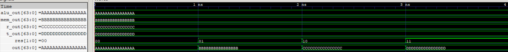

# Write Back Stage (WB)

The Write Back (WB) Stage selects the result to be written back into the register file. It uses a 4:1 multiplexer to select between the ALU result, memory output, return address, and target address based on the `res` control signal generated by the Control Unit.

   
  ID Stage 

## Features

- 64-bit result selection.
- Supports four write-back sources:

  - `00` - ALU result
  - `01` - Memory output
  - `10` - Return address (`PC + 4`)
  - `11` - Target address (`PC + immediate`)
- Parameterized data width and number of inputs.
- Combinational logic with no clock dependency.

## Interface

| Signal    | Direction | Width        | Description                |
| --------- | --------- | ------------ | -------------------------- |
| `alu_out` | Input     | `W`          | ALU result                 |
| `mem_out` | Input     | `W`          | Memory read data           |
| `r_out`   | Input     | `W`          | Return address from TAG    |
| `t_out`   | Input     | `W`          | Target address from TAG    |
| `res`     | Input     | `$clog2(IN)` | Write-back source selector |
| `out`     | Output    | `W`          | Selected write-back data   |

## Result Selection

The `res` control signal determines which result is forwarded to the register file:

| `res`   | Selected Source |
| ------- | --------------- |
| `2'b00` | ALU result      |
| `2'b01` | Memory output   |
| `2'b10` | Return address  |
| `2'b11` | Target address  |

## Verification

- RTL simulation: 4/4 directed tests passed.
- Gate-Level Simulation (GLS): Passed all 4 directed tests.
- Verified all four write-back selection paths.
