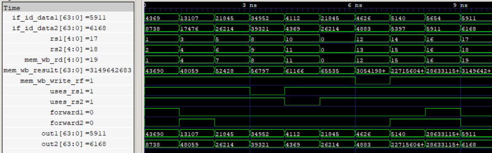

# WB-to-ID Forwarding (WIF) Unit

The WB-to-ID Forwarding (WIF) unit resolves Read-After-Write (RAW) data dependencies between instructions in the WB and ID stages of the five-stage pipeline.

It handles dependencies where an instruction in ID requires a register value that is being written back by an older instruction in WB during the same cycle. WIF detects these dependencies by comparing the source-register indices of the instruction in IF/ID against the destination register in MEM/WB.

When a dependency is detected, WIF forwards the MEM/WB result directly to the corresponding ID-stage operand input, avoiding reliance on register-file read-during-write behavior.

<p align="center">
  
  <br>
  <sub>WB-to-ID Forwarding</sub>
</p>

## Features

- Detects RAW dependencies between instructions in WB and ID.
- Supports independent forwarding paths for both ID-stage operands.
- Compares IF/ID source-register indices against the MEM/WB destination register.
- Uses `uses_rs1` and `uses_rs2` metadata to qualify source-register comparisons.
- Prevents forwarding from the zero register (`x0`).
- Qualifies forwarding using the MEM/WB register-file write control.
- Supports simultaneous forwarding to both ID-stage operands.
- Provides original register-file read data when no forwarding condition is satisfied.
- Implements combinational forwarding logic without additional pipeline latency.

## Interface

| Signal | Direction | Width | Description |
|---|---|---|---|
| `if_id_data1` | Input | 64 bits | Original first operand from the register file |
| `if_id_data2` | Input | 64 bits | Original second operand from the register file |
| `rs1` | Input | 5 bits | First source-register index from IF/ID |
| `rs2` | Input | 5 bits | Second source-register index from IF/ID |
| `mem_wb_rd` | Input | 5 bits | Destination-register index from MEM/WB |
| `uses_rs1` | Input | 1 bit | Indicates whether the current instruction uses rs1 |
| `uses_rs2` | Input | 1 bit | Indicates whether the current instruction uses rs2 |
| `mem_wb_write_rf` | Input | 1 bit | MEM/WB register-file write control |
| `mem_wb_result` | Input | 64 bits | Result available in MEM/WB |
| `out1` | Output | 64 bits | First ID-stage operand after forwarding selection |
| `out2` | Output | 64 bits | Second ID-stage operand after forwarding selection |

## Forwarding Logic

The WIF unit independently checks both source operands against the destination register in MEM/WB.

A forwarding condition is asserted when:

- The corresponding source register is used by the current instruction.
- The source register index matches `mem_wb_rd`.
- The destination register is not `x0`.
- MEM/WB enables register-file write-back.

The forwarding conditions are:

```systemverilog
forward1 = (rs1 == mem_wb_rd) &&
           mem_wb_write_rf &&
           (mem_wb_rd != 0) &&
           uses_rs1;

forward2 = (rs2 == mem_wb_rd) &&
           mem_wb_write_rf &&
           (mem_wb_rd != 0) &&
           uses_rs2;
```

The resulting forwarding decisions control two independent operand-selection paths:

```systemverilog
out1 = forward1 ? mem_wb_result : if_id_data1;
out2 = forward2 ? mem_wb_result : if_id_data2;
```

If a dependency is detected, the corresponding ID-stage operand receives the MEM/WB result. Otherwise, the original register-file read data is selected.

### Source-Usage Qualification

The `uses_rs1` and `uses_rs2` signals prevent false forwarding conditions caused by instruction fields that do not represent actual source-register dependencies.

For example, an immediate instruction may contain a bit pattern in the `rs2` field position, but that field is part of the immediate rather than a source-register index. The source-usage metadata prevents such a match from triggering forwarding.

## Verification

- RTL simulation: 10 directed test vectors verified.
- Gate-level simulation: 10 directed test vectors verified using the synthesized and technology-mapped netlist.
- Independent forwarding: Verified forwarding to `out1` and `out2` separately.
- Simultaneous forwarding: Verified both operands receiving the MEM/WB result.
- Dependency detection: Verified matching and non-matching source/destination register indices.
- Source qualification: Verified that unused source registers do not trigger forwarding.
- Zero-register handling: Verified that forwarding from `x0` is prevented.
- Write qualification: Verified that forwarding is disabled when `mem_wb_write_rf` is deasserted.
- Operand selection: Verified original register-file read-data pass-through when forwarding is not required.
